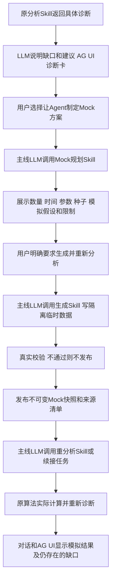

# 数据不足诊断与 Agent 生成 Mock 数据方案

审阅稿，2026年10月12日。评估基线为 `codex/cdcbuddy-refactor` 分支 `c8dccd1`。本方案覆盖四域分析、查询、报告、工作流及 Web、Widget、会话历史中的数据缺口反馈；代码实施和数据生成均在审阅通过后开展。

建议建立统一的结构化诊断协议：每次无法完成目标计算时，都说明业务场景、实际方法、所需数据、当前数据、具体缺口及可执行建议。主线 Agent 使用真实 LLM 解读 Skill 返回的诊断证据，同时生成 AG-UI 诊断卡片。对适用场景提供“让 Agent 生成 Mock 数据并重新分析”，生成的数据进入独立沙箱，重新运行现有真实算法。

## 一 目标和约束

1. 所有 `NO_DATA`、`INSUFFICIENT_DATA`，以及成功结果中某个目标输出因数据缺口无法计算的情况，都必须有具体诊断。不能只显示“数据不足”“未评估”或英文质量标签。
2. 说明中的数量、日期、缺失字段、过滤条件和模型门槛必须来自真实检查；LLM负责组织解释和选择已注册 Skills，不能凭空补出当前数据或推荐门槛。
3. 保持“主线 Agent → LLM → Skills → 对话结果 + AG-UI”。按钮点击、诊断查询、生成方案、数据生成、切换数据集和重新分析均进入同一链路。标签、数学、SQL、数据校验可以确定性实现，业务答复不能使用固定模板冒充 LLM。
4. 病媒默认使用真实来源；食源性、环境、慢病默认来源为 Mock。来源标签与计算可用性分别判断：Mock 数据同样可能为空、不合格或不足。
5. 保留原六种执行状态，不把模型尚未实现、权限不足、LLM故障、参数缺失或待专家复核统一改名为“数据不足”。
6. Mock 生成不能覆盖来源数据库、拼接伪造的真实记录、训练一个不存在的模型，或让模拟结果进入真实预警、审批、通知、复测和处置闭环。
7. 模型最小运行条件与专业效果验收条件分开呈现。满足最低条件仅表示可以运行，不能据此保证精度或科研有效性。

## 二 现状与需要改动的边界

目前 `SkillResult` 只有状态、payload、指标、来源和质量标签，没有统一的需求与现状比较结构。Python 已在 AR/GBDT、扫描、cgMLST、Pearson、Moran 等方法中实际检查条件，但检查所得细节经常没有进入返回契约。`AnalyticsResultCard` 主要解释部分病媒标签，其他领域仍可能显示英文标签或空值。

`NO_DATA` 当前要求 `payload=null`，主线 Agent 和 `projectAguiView` 会排除这类结果，导致诊断没有独立展示位置。另一方面，根状态为 `SUCCESS` 时，某个方法分组、相关性滞后、指标或地图仍可能无法计算，因此只检查根状态会漏掉场景。

已有 `scripts/seed-demo.py` 是明确执行的离线 Mock 初始化工具，仅支持三个 Mock 域，不能直接视为产品内的 Agent 生成能力。现有数据集解析通常要求每域恰好一个来源，分析 Skill 尚未把隔离沙箱的数据选择贯穿到上下文、SQL、Python 和工作流。本方案需要补齐这些边界，不能仅增加一个生成按钮。

依据：[结果契约](../../../src/contracts/skill-result.ts)、[Python封装](../../../analytics_engine/contracts/task.py)、[主线Agent](../../../src/application/agent/main-agent.ts)、[AG-UI投影](../../../src/contracts/agui-view.ts)、[分析卡片](../../../src/components/ag-ui/AnalyticsResultCard.tsx)、[数据集解析](../../../src/infrastructure/db/dataset-manifest.ts)、[现有交付边界](重构交付与剩余能力.md)。

## 三 反馈分类

| 类别 | 执行状态 | 必须解释 | 建议和 Mock 边界 |
|---|---|---|---|
| 请求范围内无记录 | `NO_DATA` | 生效的地域、时间、物种等条件；该范围实际匹配数；实际日期覆盖或尚未取得的统计 | 检查条件、选择权限内其他窗口、采集/导入；支持该表生成器时可创建沙箱 |
| 样本、连续性、有效配对不足 | `INSUFFICIENT_DATA` 或分组诊断 | 方法要求与实际有效样本；被排除的原因；可明确计算的差额 | 补采、扩大明确指定窗口、已有替代方法、沙箱生成 |
| 缺坐标、字段、投入分母、拓扑、标签 | 子输出诊断或 `INSUFFICIENT_DATA` | 缺哪个字段/关联表，多少记录受影响，阻止哪项输出 | 补数据/元数据；仅支持的方法可用模拟字段演示 |
| 不兼容或质量异常 | `INSUFFICIENT_DATA`；非法参数仍为输入错误 | 不兼容的采样方法、等位方案、计量单位；无效字段数量 | 分组、修正输入、重新导入；禁止静默合并或改写来源 |
| 参数待指定 | 原有状态配合 `PARAMETER_REQUIRED` 分类 | 哪个参数缺失、当前有哪些权限内可选项 | 由 Agent 询问并执行下一轮；优先补参数，无需造数 |
| 模型未实现或未训练 | `FAILED` + `CAPABILITY_UNAVAILABLE` | 缺实现/训练产物/外部验证，以及仍能执行的计算子集 | 可切换已有方法；不能声称生成 Mock 后该模型即可运行 |
| 专业有效性未验证 | `REVIEW_REQUIRED` 或成功结果的限制 | 已计算哪些值、缺哪个验证集/专业确认、不能作何结论 | 专家复核、真实标注/外部验证；Mock仅用于工程实验 |
| 权限、文件损坏、进程、LLM、取消 | 保留对应失败/取消语义 | 相应错误与合法恢复方式 | 不提供数据不足解释替代错误，不以造数修复基础设施故障 |
| 有记录但事件、阳性或显著簇为零 | 通常为有效零结果 | 记录总数、真实零值及计算定义；有无另外不可计算的指标 | 不诱导生成阳性/显著结果以“修复”真实零值 |

同一结果允许多个问题。每个问题绑定具体输出路径或分组，例如某一采样方法、污水厂或滞后天数；已完成的输出继续展示，不可计算的输出保持空值并附原因。诊断描述的“不能回答”必须限定到对应目标。

## 四 所有场景的覆盖清单

下表中的数字是当前实现的运行条件，不是新制定的专业标准。实施时以版本化方法策略和实际检测值为准；不得在前端另维护一套门槛。所有可调用 Skill 与别名、所有旧展示入口都进入覆盖登记表。原54项功能逐项关联到同一登记表：可运行子集登记输出缺口，planned部分登记能力说明，没有Skill入口的功能明确标为未实现，不能因没有代码分支而遗漏。

| 场景及实际方法 | 必须采集的当前证据和缺口说明 | 处置建议与生成范围 |
|---|---|---|
| 四域事实查询、自定义SQL执行、CSV导出、监测报告 | 授权后生效条件、匹配记录数、有效值数、NULL数、实际MIN/MAX日期、行数上限及是否截断；区分COUNT=0、SUM/AVG=null和有效值0 | 修正条件、权限内扩大窗口、采集/导入；支持对应事实表时可模拟。任意SQL无法可靠确定需求时说明未判定，不猜测模型要求 |
| 会话、报告、技能、任务等资源不存在 | 请求资源类型、存在性/可访问性，避免泄漏他人资源 | 使用自己的有效资源或新建；不把资源不存在包装成监测数据不足，不推荐造监测数据 |
| 病媒 AR 捕获预测 | 各采样方法实际月数、前两个月连续可用条件形成的训练对数；当前AR至少6个有效训练对；末两个月是否连续；末次事实月距asOf多少月，超过12个月停止预测 | 补连续月份、明确扩大窗口；已有GBDT同样需检查条件；可生成独立连续月序列。不把“6个训练对”写成“6个月” |
| 病媒 GBDT 捕获预测 | 同上，当前GBDT至少12个有效训练对；说明每组排除的缺月、过期数据及实际训练范围 | 补连续观测，或在条件满足时选择已有AR；模拟实际训练，禁止返回预设预测或精度 |
| 病媒滚动回测 | 每个城市×方法可训练的历史截止点、目标期真实观测、horizon、实际评估对数、被跳过的截止点原因 | 延长历史并补真实目标期；没有评估对时不能报告误差。生成后只能称合成回测。低精度是效果问题，不自动称数据不足 |
| 病媒标准密度与采样投入 | 有效投入分母数、缺失/非正分母数、方法及单位含义是否经确认 | 补正确投入和计量元数据；现有捕获/记录可继续显示。模拟分母不能验证真实密度定义，未实现的标准密度模型仍不可用 |
| 病媒IDW | 原始范围内记录数、有效坐标点数、被过滤坐标数、采样方法列表、实际空间覆盖；多方法需指定一个 | 先选方法、补坐标/点位；可生成模拟点位。当前实现可对单点计算，必须说明空间退化，不能编造统一“至少3点”门槛 |
| 病媒近似圆形Poisson扫描 | 单一采样方法；至少3个有坐标的监测点、正捕获总数；实际有效点数、捕获总数和候选窗口数 | 选方法、补点/观测；零捕获是实测情况，无法计算扫描不等于没有监测。可显式选择假设正捕获场景进行模拟 |
| 病媒物种组成、KMeans、多样性 | 总捕获、有效分组数、有坐标样本、独特特征数；全零捕获导致比例/熵分母无意义，缺坐标可能只影响聚类 | 保留“已监测但捕获为0”；补点位；模拟不同分布。当前实现单一特征返回单簇，应解释退化，不虚报缺少固定样本门槛 |
| 病媒PCR比例与两项关联 | 有效PCR记录、阳/阴/不合格结果数；联合阳性计数，当前关联规则至少2次联合出现；分别说明无规则、无阳性和无检测记录 | 展示真实零比例/无规则；补相关检测。仅需演示关联时生成假设阳性交易，不能把真实阴性结论改为风险提示 |
| 病媒生测历史、抗药演化、传播输入摘要 | 实际生测年份/记录，基因型字段、敏感株LC50参考、人口暴露缺失情况；实际捕获分组/PCR数量 | 可展示已登记分类和输入摘要；模拟基因/参考仅作为数据样例。经过验证的传播/基因演化模型仍不可用 |
| 食源性cgMLST | 同病原分组数量、有效非空非负整数向量数、无效数、各向量长度、分型方案及版本是否登记、sampleLimit及截断 | 按病原/方案分组、修正格式/补方案/补菌株；两株以上才有株间比较。不能仅因长度相同声称生物学可比。可生成有统一模拟方案的等位向量并实际算距离 |
| 食源性暴露窗口与溯源候选 | 时间/地域内病例数、暴露字段有效数、是否仅有场所类型而无场所标识，实际候选窗口样本 | 补暴露与场所标识、扩大窗口；无候选可能是有效结果。模拟病例/暴露关联只支持现有候选算法，不确诊暴发或源头 |
| 食源性OR及归因 | 病例暴露数据、未暴露/对照表及字段是否存在和有效；不要把病例数当对照数 | 导入对照并建设验证方法；现有仅记录汇总。生成模拟对照可演示数据需求，但当前未实现OR计算时不可承诺重新计算OR |
| 环境饮用水实测汇总 | 各水质/已有CR、HQ字段的有效数、NULL数、坐标数、实际样本截断情况；若某字段全部NULL必须拒绝非有限均值 | 补指标/坐标；已登记风险字段与新模型输出区别展示。RF、克里金未实际执行，不得称补Mock即完成训练/插值 |
| 环境污水日历滞后Pearson | 每厂、每个lag的实际配对日期数；当前需至少4对、双方非恒定且数值有限；lag0..30；日期错位、缺值、常量分别说明 | 补匹配日期/相关指标、明确调整窗口或lag；禁止按行移位凑配对。可生成受控日期序列后实际计算，不保证显著性或最优lag |
| 环境污水源头追踪 | 管网、流向、厂站与医院关联是否存在并验证；已完成Pearson不能等同锁定源头 | 补拓扑/业务关联；模拟拓扑独立标注。未实现的溯源模型不因模拟拓扑产生真实源头结论 |
| 环境河流Moran | 断面有效值、是否提供权重、断面键一一匹配、矩阵维度/非负/有限/零对角；当前3..50断面、权重和>0，数值非恒定 | 提供实际权重或补有效断面；合法但恒定序列说明统计不可辨识。无权重可继续描述均值。可生成显式模拟拓扑并调用现有Moran，不制造真实河网 |
| 慢病月死亡数和区县中心DBSCAN | 死亡记录、有效区县中心坐标、无法匹配/缺坐标的区县和记录数量；eps/minSamples，当前minSamples允许2..100 | 补区县中心或选择合法参数；0簇/全噪声仍可能计算成功。模拟区县中心不能声称个体死亡位置或真实风险 |
| 慢病罕见码与伤害候选 | 相关病例、时间/类型/位置字段有效数；当前罕见码规则14天至少3例、伤害24小时至少5例；窗口是否有候选 | 区分未达到候选条件与数据缺失，说明需复核；可生成假设聚集场景。门槛只是当前经验规则，不是临床诊断标准 |
| 慢病死因质控及ICD编码候选 | 证明书是否存在、死因链字段完整性、规则/字典覆盖、未知术语、专业标签与外部验证是否缺失 | 补字段、专家核实；未知编码不能固定给答案。可生成模拟证明书验证规则，不能伪造质控准确率 |
| 慢病人口率、寿命表、风险GBDT、ROI | 人口分母、年龄/性别分层、随访、训练标签、费用/效果等当前是否存在；方法本身availability | 先说明能力缺实现与数据缺口；模拟表只演示输入，不激活不存在的模型，不能发布真实人口率/寿命/ROI |
| 后台分析、预警任务、审批和复测 | 保存原分析诊断；任务失败可否重试；复测政策、单位、同方法/物种、采样时间、专家审核、有效测量数 | 补合格真实证据、等待政策规定时间/复核；缺数据不是瞬时异常，不无限重试。Mock只用于隔离工作流测试，不能关闭真实工单 |
| 原清单中其余planned能力 | 由注册表说明未实现、训练/验证缺口及可用替代方法 | 统一能力说明，不伪造模型数据门槛；没有可运行方法时禁用“生成后自动重算该模型” |

覆盖登记文件拟为 `config/data-requirements.json`，键为规范Skill ID + methodVersion + outputKey；别名指向同一规则。结合 `config/skill-requirements.json`、`config/analytics-tasks.json` 和能力清单自动检查覆盖，不凭页面文案搜索宣称完整。新方法增加可缺失输出而未登记需求时，CI失败。

## 五 统一诊断协议

新增 `DataDiagnostic`，作为 `SkillResult` 的独立字段 `diagnostics[]`，不塞入业务payload，不依赖图表存在。升级 `SkillResult` 到schemaVersion `2`，TypeScript Ajv和Python Pydantic同时校验；事件与AG-UI外层版本暂保持`1`，其嵌套结果明确为v2。

| 字段 | 内容和约束 |
|---|---|
| identity | `id、runId、skillId、outputKey、groupKey?、domain`，绑定这次执行及受影响输出 |
| scene | 业务场景、用户期望目标、生效地域/时间/过滤条件；均使用服务端批准后的上下文 |
| method | 实际方法标识、版本、availability；最低运行条件和专业验证状态分别记录 |
| datasets | 引用结果中的DatasetRef；包含origin/version，事实日期范围来自实际检查；不暴露文件路径 |
| category / severity | `NO_MATCH / SAMPLE_GAP / TEMPORAL_GAP / SPATIAL_GAP / FIELD_GAP / COMPATIBILITY / QUALITY / PARAMETER_REQUIRED / CAPABILITY / VALIDATION / RESOURCE`；`blocking / partial / informational` |
| reasonCode | 稳定代码，如`TRAINING_PAIRS_BELOW_MINIMUM、LAG_PAIRS_BELOW_MINIMUM、CONSTANT_SERIES、MISSING_TOPOLOGY、ALLELE_SCHEMA_MISMATCH、MODEL_NOT_IMPLEMENTED` |
| checks[] | 每项含`key、requirement、observed、gap、state、evidenceRef`。requirement包含单位、比较运算、门槛/字段、策略版本及依据种类；observed标明已测/未取得/被限制 |
| impact | 无法生成哪些输出，仍能提供哪些已计算结果；不能泛化成全部功能不可用 |
| actions[] | 服务端注册的动作id、目标Skill、依据诊断id、可执行性、所需权限、适用数据模式、输入约束、预期帮助和限制；不是任意URL/SQL |

具体接口、枚举和校验放在实施计划中。诊断id以runId/输出/分组/规则为基础稳定生成，聚合不重复展示同一问题。所有不足状态必须有至少一个阻塞诊断；成功结果的缺口必须指向相应子输出。

检查结论区分`met / unmet / unknown / not-applicable`。未取得实际统计时显示“尚未检查”，不能写0。只有要求和观测都是可比较数字时才计算缺口；连续训练对、拓扑和专业标签不能用“还需N条原始记录”替代真实约束。

依据种类至少有`implementation-minimum / engineering-policy / validated-domain-rule / expert-confirmation-needed`。注册当前门槛时保留它们的真实依据；未验证的专业样本要求写“需要专业确认”，LLM不得自行设为30、100或某个精度目标。

诊断优先在执行原SQL/算法的同一快照中采集。额外统计采用受限profile查询，先授权再查询；不得额外扫描全省或未授权城市来解释空结果。匹配数量不能用最多200行的返回长度假装总数，cgMLST等自身限额也必须披露。profile失败只表示对应现状未知，不能误判来源为空。生效scope使用白名单字段，不把自由输入、SQL或文件路径直接序列化到公共诊断；低权限角色对小样本敏感统计按现有策略抑制，显示restricted而不暴露原值。来源文件缺失、schema损坏或版本不兼容属于来源/基础设施故障，不能伪装成零记录。

## 六 对话与 AG-UI 展示

对话先说明“哪项目标无法完成”和最主要缺口，再给可执行建议。AG-UI统一增加 `DATA_DIAGNOSTIC_CARD`，默认展示以下六块：

1. 场景与目标，例如“郑州市诱蚊灯法未来3个月捕获预测”。
2. 实际方法与适用边界，例如“AR捕获/记录预测，最低运行条件尚未满足”。
3. 数据要求，例如“至少6个有效连续训练对，且最后两个月可用”。
4. 当前情况，例如“8个观测月、3个有效训练对，末两个月不连续”；同时展示origin、实际日期范围和过滤条件。
5. 原因及影响，例如“缺月破坏前两个月滞后特征，不能训练；实际历史均值仍可查看”。
6. 建议动作，例如“补连续月份”“重新选择时间窗”“让Agent制定Mock方案”。不适用的动作显示具体不可用原因。第一批尚未开放生成时，Mock入口显示“生成能力尚未启用”；采集、导入或替代模型动作只绑定已实现且获授权的Skill，未实现入口不得伪装成可执行按钮。

展开区显示逐项检查、缺月/缺字段清单、受影响分组及追踪id；大量清单分页展示，绝不靠裁剪后的清单推断缺口总数。身份受限用户仅看到允许的统计，不能通过缺失字段或原始病例标识泄漏敏感信息。

`NO_DATA / FAILED / CANCELLED` 仍保持业务payload为空并清除旧图表。允许展示本次Skill已产生的诊断和本次错误；不得复用上一轮成功地图，也不得将诊断卡伪装成成功分析。取消时只展示已完成检查，未完成检查为unknown。LLM失败仍为失败：保留实际Skill诊断供查看，不生成固定业务对话兜底。

所有根结果和分组结果都参与诊断投影：根成功、局部不足时显示成功输出加局部诊断；全无数据时只显示诊断。获取profile或生成Mock方案成功，不能反过来把原不足分析改成成功。多Skill各自状态保留，根状态沿用明确的聚合规则。

Web、Widget、移动协议、SSE、HTTP薄适配、后台任务详情、会话快照、已生成报告和导出说明使用同一diagnostics。纯诊断可保存为“诊断报告”，不计作已完成的监测分析报告，也不能在无数据时自动归档空分析。

旧v1结果只读兼容，标明“历史执行未记录数据诊断”；不得从旧payload猜测当时数量。提供“按当前数据重新诊断”动作，经Agent生成新的run。v2写入启用后全部新运行使用v2，读入v1适配仅用于历史，不允许新算法悄悄退回裸提示。

## 七 Agent 生成 Mock 数据的真实闭环

### 生成入口与执行步骤

“让Agent制定Mock方案”只执行只读规划Skill，不写数据。用户明确提出生成请求，或审阅具体生成方案后选择“生成并重新分析”，才允许执行写Skill；原始问句“为什么不足”不授权造数。

新增四个规范Skill：`skill_data_diagnose`、`skill_mock_plan`、`skill_mock_generate`、`skill_analysis_rerun`。它们复用原领域分析，不另写一套“演示算法”。生成和重算超过当前一轮工具/时间预算时，通过现有持久Job续接主线Agent，不突破3轮8次工具预算，也不在前端直接执行Python。

`MockPlan` 包含原diagnosticId和原Skill及参数、模板/生成器版本、schemaVersion、目标行数、时间范围、地域、seed、所有模拟假设、质量目标、预计预算、到期时间、可重算范围。参数变化产生新plan和新版本；执行时重新校验原诊断可见性、来源版本、权限、模板和预算。原来源变动时先提示并重诊断，不依据过期缺口自动生成。

生成器使用约束参数、固定seed和真实算法构造记录；LLM负责形成结构化需求，不能直接执行其生成的任意Python、SQL或大段虚构CSV。不使用固定表格或预设最终分析结果作为输出。允许稳定的schema、字段字典和生成分布，必须保证参数变化会改变数据，实际分析对数据扰动有对应响应。

### 首批支持的生成模板

| 模板 | 可配置内容与校验 | 可以实际重算 | 不能宣称 |
|---|---|---|---|
| 病媒捕获时间/空间/PCR/生测 | 采样方法、连续月、每月数量、坐标范围、非负捕获、PCR类别、关联概率、生测记录；外键及投入字段语义校验 | 已有AR/GBDT/回测/IDW/KMeans/近似扫描/PCR两项关联/生测摘要 | 标准密度已验证、真实传播风险、基因演化模型已实现 |
| 食源性病例与cgMLST | 合法时间/地点、合成暴露标识、病原分组、统一模拟分型方案、非空非负整数等位向量、外键 | 已有病例汇总、窗口候选、实际等位距离与候选簇 | 真实暴发/源头、尚未实现的OR或预测模型已可用 |
| 环境水质、污水日历、断面与模拟权重 | 指标范围、缺值比例、日期频率、假设滞后/噪声、非恒定可选；断面与权重一一匹配 | 已有指标描述、Pearson、Moran；模拟权重以版本化附件传入原方法 | 克里金/RF/DLNM或真实管网溯源已完成 |
| 慢病死亡、伤害、证明书与区县中心 | 合成时间/死因/年龄字段、区县中心、可选候选窗口、外键；不复制真实身份 | 已有死亡数、中心DBSCAN、罕见码/伤害候选、经验质控 | 真实死亡风险、个体位置、寿命表、GBDT或质控准确率 |

每个模板支持“满足运行条件”和“保留指定缺陷”的测试模式，默认不保证统计显著、聚类、规则或好精度。后者用于验证诊断有效性，重算仍可返回不足。加入新表、对照、拓扑或标签模板前，需实现其schema、生成和校验；没有生成器时如实不可用。

不在真实快照内“补几条Mock”。首期仅生成完全独立的合成数据；公开字段字典和授权后的目标条件可作为约束，不从个人病例抽样或复制敏感原始记录。当前三个域已有Mock库也必须创建新的隔离版本，不能修改既有默认库。

### 隔离、权限与生命周期

服务端新增数据集注册记录，保存`datasetId、owner、organization、domain、jurisdiction、origin=mock、purpose=simulation、parentDiagnosticId、planId、generatorVersion、seed、参数摘要、行数、校验摘要、内容hash、createdAt、expiresAt、状态`。服务器拥有文件路径，客户端/LLM仅能选择已授权datasetId。路径穿越、任意路径、跨域/跨组织引用一律拒绝。

默认来源模式为`source`；Mock生成后的重算显式绑定`simulation`和新datasetId。这次分析及会话中的数据选择持续显著显示“模拟数据”，恢复原来源也通过Agent动作执行。API、SQL仓库、Python runner、报告、下载、后台任务均解析同一执行数据上下文，不能依赖进程全局环境变量切换数据库。

拟增加独立权限`manageMockDatasets`：由管理员显式授予，建议首先授予需要演示的市级专家；基层默认可诊断和申请方案，未经授予不可生成；PUBLIC_VIEWER禁止写入及访问他人沙箱。诊断读取仍遵守原域、辖区、敏感列与所有权限制。数据集归属及每次执行权限均服务端校验；有专业审批权限不自动具有造数权限。

建议配置默认值：local/demo可显式启用，pilot默认关闭，可由部署配置开放隔离模拟功能；单次生成最多10,000事实行、50MB，运行120秒，每用户并发1、最多3个活跃数据集，总体生成并发2，默认保留7天。以上是拟定工程预算，配置内管理，非模型门槛；事实行预算按所有生成事实表累计，50MB为快照及附件发布总量，120秒为含生成与校验的整体预算；超预算由Agent给出缩小规模或分批方案，不无限放开。

生成过程`PLANNED → GENERATING → VALIDATING → READY / FAILED / CANCELLED`，文件采用独占临时创建、真实校验、内容hash后原子发布。只有READY可分析；取消/失败不发布半成品。以用户+组织+planId+generationRequestId保证重试幂等，同一生成请求返回原任务，新seed/参数需要新plan或明确新请求。

模拟模式服务端禁止创建真实预警工单、审批、对外或站内真实通知、复测消警以及改写观察事实。即使调用另一轮Skill、后台Worker或伪造客户端上下文也不能解除限制。首期不建设“模拟审批通知”子系统；如需演示闭环，后续使用独立测试命名空间。

删除沙箱经Agent调用管理动作校验所有权；到期清理是后台基础设施。运行中的快照获得租约，删除/过期先撤销新运行再待租约结束清理；历史保留来源清单、诊断、参数和结果摘要，标注文件已过期不可重跑。保存文件使用最小权限，包含合成个人字段的沙箱也按敏感数据权限处理。

## 八 示例展示

以下数字均为设计示例，不代表当前数据库重新测得的事实。正式输出必须由实际Skill填写。

**例一 AR连续训练数据不足**

> 当前无法完成郑州市诱蚊灯法未来3个月捕获预测。该AR方法至少需要6个有效训练对，并要求末两个月连续可用。本次范围有8个观测月，但只有3个有效训练对，且末两个月不连续，因此不能训练；缺少的是满足滞后特征的连续记录，不能简单等同“再加3条”。可以补齐缺月、重新选择时间窗，或让Agent生成独立连续月Mock数据用于演示。模拟预测不能证明真实预测效果。

卡片同时给出实际缺月清单、训练对形成规则、来源observed、截止日期；Mock卡和原诊断分开，不将原observed结果改成成功。

**例二 污水某滞后没有足够配对**

> 某污水厂lag=1天只有0个匹配日期，当前Pearson需要至少4个有效配对且两侧数值非恒定。样本均为每7天采集一次，不能用“下一条记录”冒充“次日”。lag=0或7天若已实际计算可继续展示；可以补日尺度观测，或生成明确假设为日采样的模拟序列后重算。没有管网拓扑，相关性结果仍不能锁定源头。

**例三 cgMLST不兼容**

> 同一病原的8株中，6株具有100个位点、2株具有80个位点，当前方法无法把这些向量放在同一个距离矩阵中；分型方案元数据尚未取得。请确认统一分型方案并重新导入，或按可确认方案分组。也可生成统一模拟方案的合成菌株，用于演示候选簇算法，不代表实际源头。

**例四 河流拓扑缺失**

> 已获得5个断面的水镉均值，但没有与这5个断面一一对应的空间权重矩阵，无法计算当前Moran。可以提供实际断面邻接及权重，或生成明确标记的模拟权重进行演示；现有描述统计仍可查看。模拟权重不能代替真实流向和污染传递证据。

**例五 模型没有实现**

> 当前LSTM能力尚未实现或接入训练产物，状态为能力不可用。生成Mock时间序列不能使该模型自动可运行。可以选择已实现且输入条件满足的AR/GBDT；其模拟数据方案可以单独制定。

**例六 有效零值**

> 本次有效PCR检测20条，阳性0条，记录阳性比例为0%。这是本次监测结果；未产生联合阳性规则也不等于没有检测数据。若希望测试阳性关联功能，可以另建假设阳性场景的模拟数据，但该模拟结果不会改变当前监测结论。

## 九 验收标准与交付顺序

建议两批上线，共七个实施任务。第一批完成诊断契约、实际检查、四域接入、LLM说明和所有展示出口，不依赖Mock生成即可验收；第二批完成隔离上下文、受控生成和真实重算，再验证跨端完整闭环。

| 验收项 | 通过条件 |
|---|---|
| 完整覆盖 | 所有可调用Skill/别名、根不足和局部缺口都登记并有测试；不存在只有“数据不足”的新结果 |
| 解释真实 | 要求、现状、缺口、影响、建议齐全；计数/日期来自同次授权检查；unknown不冒充0；无门槛的场景不编数字 |
| 语义正确 | 零值、无显著簇、能力不可用、待复核、权限、LLM失败各自保留语义；多方法/多厂局部不足不吞掉 |
| 主线一致 | 所有功能按钮都触发真实LLM和Skill；Skill结果具有runId与来源；静态模板不能完成业务对话 |
| UI与历史一致 | HTTP/SSE/Web/Widget/移动协议/报告/任务/会话显示相同诊断；NO_DATA显示本轮诊断并清除旧图 |
| 生成真实 | seed和版本可复现；参数/数据扰动影响真实算法输出；校验不通过不发布；不足未解决时重算仍报告不足 |
| 隔离正确 | 原来源文件hash不变；Mock从UI到SQL/Python/报告始终标记；混入观察来源及真实工单/通知/复测操作全部被拒 |
| 权限可靠 | 跨组织/辖区/所有权、匿名、公众写入、任意路径、过期及权限撤销场景被拒；profile不泄漏越权数据 |
| 故障恢复 | 生成重试幂等、崩溃无半成品、取消/到期有清理、异步续接受原身份和模拟范围限制 |
| 回归与真实LLM验收 | 全部现有检查通过；新增科学/契约/权限/端到端测试通过；四域至少一条实际LLM诊断链和生成重算链留存证据 |

部署前先升级兼容读者，再同步升级Skill、Python协议、Agent和UI的v2写入路径，不允许新旧进程互相发送无法识别的嵌套契约；必要时使用隔离灰度实例。发布使用两项开关：`DATA_DIAGNOSTICS_V2_ENABLED`及`MOCK_GENERATION_ENABLED`。第一项关闭恢复原协议写入，但数据库需先采用可读新旧记录的版本；已有v2记录不降格。第二项关闭停止新生成和模拟写操作，历史结果仍可按原权限只读。试点先启用诊断，验证后按角色开放Mock生成。

本方案不同时承诺补齐LSTM、DLNM、寿命表、真实归因、完整拓扑溯源等专业模型，也不改写既有专业最低条件。若审阅要求将这些能力一并实现，应各自制定模型、训练、验证和数据接入方案。

详细实施任务见 [数据不足诊断与Mock生成实施计划](../../superpowers/plans/2026-10-12-data-insufficiency-plan.md)。本轮只提交方案，不执行生成或业务数据写入。
