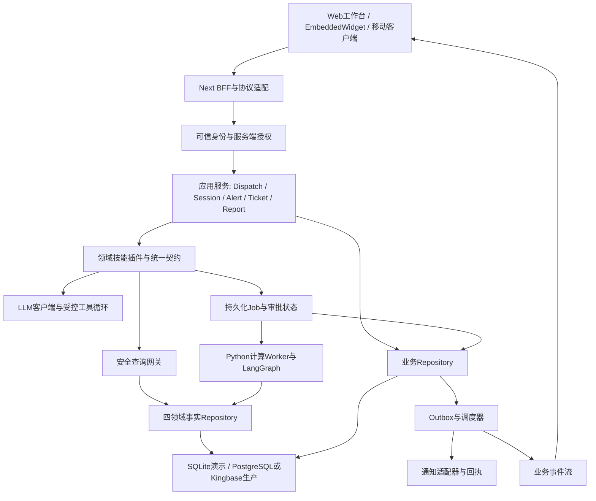
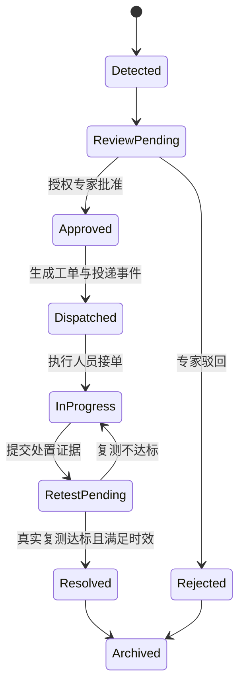

# Agent-CdcBuddy 架构重构与分阶段改进方案

> **交互约束补充：**用户进一步要求：Mock仅限输入数据；所有功能必须实际执行，且通过主线Agent的LLM+Skills返回对话结果和AG-UI。不得保留固定成功演示或关键词规则绕过LLM。以修订计划v3为准。

**日期：2026-10-12（北京时间）｜状态：待用户审阅，尚未执行**  
依据：[项目成果与架构评估报告](项目成果与架构评估报告.md)。本方案区分工程重构、业务补齐与科学模型研发；重构本身不会使固定示例变成有效模型。

> **实施计划已修订：**用户确认仅病媒使用真实数据，其余三域为Mock，RBAC尚未实现。以[2026-10-12修订重构实施计划](../../superpowers/plans/2026-10-12-cdcbuddy-refactor-plan.md)的任务顺序、范围和估算为准。本文件保留为原架构方案背景；三域Mock不再作为数据来源不明问题，RBAC按新增能力建设。

## 1. 目标和取舍

将当前“四领域交互原型与部分真实计算”升级为**结果可追溯、权限可信、业务可闭环、模型可验证**的平台。保持Next.js/React、Python及现有专业UI组件，按领域划分模块；先集中共享内核，再分离长时间计算执行。

| 选项 | 优点 | 成本/风险 | 建议 |
|---|---|---|---|
| 继续仅修大Switch与UI | 短期演示成本低 | 权限、模拟混入、代码重复与业务断点继续积累 | 仅适合阶段0—1止血 |
| 模块化单体 + 计算Worker | 最大化复用；前后端边界、任务生命周期和领域隔离清晰 | 需要统一契约、数据层和渐进迁移 | **推荐** |
| 四领域全部拆为独立微服务 | 可独立部署 | 当前共享数据/身份/流程仍未稳定，分布式事务与运维成本提前增加 | 先保留领域模块，待负载/团队证据证明必要再拆 |
| 全面换框架重写 | 可重新设计 | 丢失交互资产，功能回归和数据迁移风险高 | 不采用 |

短期避免引入无验证收益的新技术。已有SQLite保留为显式demo/test后端；真实多用户试点优先集中业务库与持久作业。PostgreSQL或Kingbase由实际部署环境决定，不能仅据SQL相似性声称兼容。

## 2. 目标架构和模块责任



| 模块 | 必须承担 | 不应承担 |
|---|---|---|
| BFF路由 | HTTP参数解析、身份上下文获取、请求关联ID、SSE事件编码和断连处理 | 统计计算、业务状态转移、拼接大段领域提示词 |
| 应用服务 | 用例编排、事务、幂等、授权调用、作业/会话生命周期 | 前端组件状态、底层SQL拼接 |
| 领域模块 | 业务规则、技能定义、领域输入/输出、计算策略、需求映射 | 接受客户端声明的高权限角色 |
| LLM适配 | provider配置、结构化工具调用、超时/重试、预算、解释生成 | 决定数据访问授权或凭文本直接执行任意工具 |
| 安全查询网关 | 域/表/列/行允许范围、SQL解析、只读执行、成本与行数限制 | 任意SQL写业务库或从LLM获取辖区 |
| Python Worker | 有界并发、计算、状态检查点、模型版本、取消和任务恢复 | 携带UI结构或静默返回示例结果 |
| Repository | 强制域/辖区与时间范围、驱动差异、参数化查询、迁移 | 合成专业指标、解释文本与UI布局 |
| Outbox/通知 | 事务事件、幂等投递、实际provider响应、回执和重试 | 将“已入库”标记为“已送达” |

### 2.1 建议目录（批准后创建）

```text
src/
  app/api/                         # 保留路由，收敛为薄适配
  application/
    dispatch/ sessions/ alerts/ tickets/ reports/ collection/
  domains/
    vector/ foodborne/ env/ chronic/
      skills/ rules/ repositories/ schemas/
  infrastructure/
    auth/ db/ llm/ analytics/ query-gateway/ events/ observability/
  contracts/                      # API、技能、任务、事件、UI payload
  features/
    workbench/ chat/ session-history/ skill-management/
  components/ag-ui/               # 保留已有展示组件
analytics_engine/
  api/ jobs/ graphs/ contracts/ repositories/
  algorithms/vector/foodborne/env/chronic/
  models/                         # 模型manifest与加载接口；大文件外置
migrations/
  sqlite/ postgres/ kingbase/
tests/
  unit/ contract/ integration/ e2e/ scientific/ deployment/
```

不做一次性目录大搬家。旧路径先代理新服务；每次迁移一个领域/用例，保持可回滚。TS到Python契约采用同一版本化schema源，生成或校验双方类型，避免手写两套后逐渐漂移。

## 3. 优先设计决策

### 3.1 统一技能定义，避免注册与执行脱节

每个SkillDefinition包含：`id/aliases/domain/requirementIds/inputSchema/outputSchema/permissions/executor/uiType/version/dataRequirements`。注册表从各领域模块汇集，参数校验、执行和UI映射均从该定义生成。

所有调用路径——直接API、LLM tool、规则兜底、嵌入浮窗、自定义技能——都经过同一执行服务。先认证，再授权，再校验输入，最后执行与审计。权限过滤工具列表可以改善体验，但不能替代执行时授权。

自定义技能为持久化的受限查询定义，不允许用户上传任意代码执行。保存时、编辑时、执行时都校验；根据技能存储的domain取得Repository，而不是固定病媒provider。private只能由owner或经授权管理者访问，public也受调用者辖区和列权限限制。

### 3.2 统一结果可信性和状态

建议结果契约至少包含：

| 字段 | 含义 |
|---|---|
| `requestId/runId/skillVersion` | 调用与执行版本定位 |
| `executionStatus` | SUCCESS / NO_DATA / INSUFFICIENT_DATA / FAILED / CANCELLED / REVIEW_REQUIRED |
| `dataOrigin` | observed / imported / synthetic / demo；由数据源元信息确定 |
| `methodKind/methodVersion` | statistical / learned-model / rule-based / scenario，与实际算法一致 |
| `domain/jurisdiction/asOf/dataWindow` | 数据范围、截止时间和样本窗口 |
| `sampleCount/modelVersion/datasetVersion/seed` | 复现条件；未训练模型不能虚填版本 |
| `qualityFlags/assumptions/limitations` | 缺失、样本不足、固定假设和降级说明 |
| `metrics` | 实际评估值、评估数据集ID、评估时间、指标定义；未评估返回null |
| `payload/schemaVersion` | 校验后的UI数据 |

先删除生产输出的虚构达标/送达/核销/准确率声明。演示结果可以继续展示，但必须显式标“演示数据”，并不能触发真实推送、处置和专业发布。结果状态来自执行器，不能靠生成文本判定成功。

纠正统计口径：比例内部使用0—1，展示层转百分数；max/mean不同字段；风险、捕获数、只/灯、BI不能混为同一单位。地理和时间筛选无数据时不能隐式扩大范围。

### 3.3 服务端授权与数据范围

接入已有组织身份系统时优先复用；若暂无统一身份系统，先以服务端会话形成可信principal。JWT可作为承载形式，但真正需要的是经验证的身份和授权上下文。

授权上下文包含用户、机构、角色、领域、辖区、资源归属与操作能力。客户端role/userId仅可用于显示，不能决定权限。会话读取/追加/修改/删除均验证owner；私有技能同理。公众访问只能查询允许的聚合视图，限制姓名等敏感字段。

SQL网关先支持明确范围的SELECT/必要CTE，使用语法树检查单语句、表/列允许列表和函数规则；限制显式LIMIT上限、超时、结果字节和查询并发。数据行范围优先通过受控视图/查询构建器与Repository强制实现；不能仅把`city`拼在LLM提示词里，也不能盲目在任意SQL末尾追加条件。

### 3.4 计算执行与流式协议

第一步改造现有CLI Runner：可配置路径、任务白名单、参数schema、超时、取消、最大stdout/stderr、并发上限和严格JSON。stderr作诊断，stdout只返回一份有效结果；禁止正则清洗把非有限值悄悄变成正常结果。

第二步增加持久Job和长驻Python Worker。短查询同步执行；重扫描、预测和多步图返回jobId，前端订阅作业事件。根据实际负载决定是否增加Redis队列；小规模先用持久化任务表与有限Worker，避免同时引入多套基础设施。

流式/非流式共享DispatchService。先保留当前兼容事件，通过适配器迁移到版本化事件：run_started、tool_started、tool_completed、view_ready、run_failed、run_completed。业务告警是独立事件类型/订阅入口，不能混同LLM token流。

重连必须验证权限、支持事件序号和去重。请求断连应取消尚未持久化的临时请求；已提交的持久任务按明确策略继续，并可由用户主动取消。多工具循环有最大步数、时间、token/成本预算，执行权限逐步检查。

### 3.5 真实预警、审批与处置状态机



不是所有低风险预警都必须人工批准；按领域规则配置审批门槛。需要审批时，LangGraph使用真实中断与持久检查点，thread_id/run_id关联业务审批，批准/驳回必须有授权与审计。未批准时不得继续执行通知和派工副作用。

工单与预警状态转移通过同一事务/事件实现，保存before/after指标、单位、复测时间、采样记录、附件、操作人、规则版本。48h规则来源于项目业务设计，实施前应确认允许的复测时窗，不能用固定数值代替检测。

通知状态独立建模：QUEUED → ACCEPTED_BY_PROVIDER → DELIVERED / FAILED；真实通道不能只填SENT。Outbox与业务事件同事务写入，消费幂等，重试耗尽进入可见失败状态。

巡检应有持久策略、调度间隔、数据水位、任务租约、心跳和异常重试；重复扫描不能重复通知。先完整支持病媒一个领域，再共享调度与告警内核扩展其他领域。

### 3.6 数据层与部署统一

事实数据接入记录datasetId、来源、schema版本、导入批次、截止日期和质量报告；与算法输出关联。生产环境禁止自动调用Mock初始化，数据库缺失或迁移失败必须使readiness失败。显式demo模式可以初始化样例，并在UI与API标识。

业务表迁移移出运行时请求，使用版本化迁移脚本和一次性迁移任务；避免四容器启动时同时改共享SQLite。演示SQLite使用合适事务、busy timeout与WAL，需验证共享文件部署限制；正式多实例业务数据使用集中数据库。

逐个实现Repository：病媒事实、其他三域事实、会话、技能、预警、工单、采集、报告、审批、任务与outbox。Python通过同一配置和受控数据接口/只读连接使用数据，不能留下项目根绝对路径旁路。

由服务端提供唯一runtime profile：domain、显示名称、可用能力与schema版本。前端不依赖公网端口猜领域，也不依赖运行时修改已编译的NEXT_PUBLIC变量。相同镜像应在自定义端口下正确显示四个领域。

健康检查分liveness/readiness：进程运行与依赖可用分开；readiness覆盖领域配置、事实源、业务迁移版本和Worker连接。不把外部LLM短暂故障直接当所有只读统计服务不可用，而是暴露对应能力状态。

## 4. 科学算法与业务补齐路线

### 4.1 先恢复事实口径

立即修正水质百分比与max/mean、城市筛选、零阳性、无数据结果、未知死因拒绝编码、cgMLST缺失向量；移除R²截断和固定“达标”声明。把NumPy随机LSTM标为实验原型，不能按训练模型发布。

算法名称应与实际方法一致：AR+季节因子写成该方法；经验评分写成规则评分；已有CR/HQ读取写成风险字段统计；复制点位写成观测分布；按名次分组不能叫DBSCAN。

### 4.2 按数据可用性补齐

| 模块 | 必要数据 | 补齐工作 | 最小验收证据 |
|---|---|---|---|
| 病媒预测No.23/30 | 分方法采样努力量/单位、连续时序、气象实际与预测输入 | 建立密度口径和时间切分，季节基线→ARIMA/GBDT→有训练价值再引入LSTM | 时间滚动测试，按地市/季节分层的误差及置信区间覆盖；≤10%指标定义需先确认 |
| 抗性No.25/32 | 浓度-死亡测定、样本量、敏感参考株、基因检测、用药频率 | LC50估计和不确定性、验证分级；有基因/用药数据后再实现演化模型 | 对照标准计算/专家标注；未知药剂、零样本、外推范围；无基因数据不宣称KDR实测预测 |
| 扫描/聚集No.27/36/63/69 | 观测时间、坐标、人口/采样努力分母、未预标记事件 | 动态时窗、合理期望、空间与时间扫描、稳定种子和显著性检验 | 注入热点/无热点独立样本、假阳性/检出率、时间阈值和<15分钟事件响应 |
| 食源预测与溯源No.37/38 | 病原、暴露史、供应链批次、序列位点质控 | 合理预测方法、MST有效位点、供应链实体关联；相似度与因果结论分开 | 缺失位点不误判同源，传播链证据完整，时间外部验证 |
| OCR/标化No.42/43 | 真实图片/PDF、字段标注、单位和编码字典 | OCR适配、字段置信度、人工校正、异常/缺失管道与审计 | 文件类型/大小/恶意格式处理；独立字段级准确率、单位转换与填补质量 |
| 水质/污水No.44—47 | 原始暴露参数、同步时间序列、管网拓扑、坐标 | CR/HQ计算与RF实际模型、Kriging网格、水质趋势、滞后相关、管网搜索 | 对照公式、真实相关/置换显著性、空间交叉验证；替换数据后结果相应变化 |
| 公共场所No.48/49 | 全维卫生评分项、规则版本、健康结局 | 专门评分模型与等级、健康效应映射、复评历史 | 正/反边界案例、缺项策略、规则可维护、评级可追溯 |
| 空气/气候/流域No.50—53/57 | 活动模式、天气预报、门诊/死亡结局、空间权重、污染源数据 | 暴露与DLNM拟合、72h预测、Moran/LISA、假设情景模型 | 时间外部验证、空间置换、基线对照；情景结果注明假设，避免把相关当因果 |
| 死因No.59—61 | 去标识专家标注证书、覆盖病种、有效编码/规则版本 | 缺失重复规则、真实NLP/规则引擎、拒判与人工复核 | 检出率≥98%、编码≥95%在独立标注集计算；同时报告误报、拒判和类别覆盖 |
| 慢病No.64—66 | 个体特征、结局、随访时间、筛查成本及资源 | 个体预测、真实并发症挖掘、可执行高危名单与成本收益参数 | ≥80%指标明确后计算；另报AUC/校准、类别比例、外部验证；ROI敏感性 |
| 伤害No.67—69/76 | 时间、年龄、位置、诱因、完整事件记录 | 真正聚类/树模型、取消is_cluster预筛、路段/社区建议关联 | 时窗和事件检出反例、规则/模型解释；不将普通树分类称因果结论 |
| 报告/模板/移动No.34/41/56/58/72/73 | 已验证指标、模板schema、采集业务字段 | 领域报告服务、周期任务、模板版本/预览、文件渲染、离线采集同步 | 报告值=源结果，导出文件可读且图表完整；离线重试幂等、审核后更新事实层 |

### 4.3 效果验证的统一要求

数据分为开发/训练、验证、最终测试；按时间与地理防止泄漏。合成数据用于工程回归与受控算法边界，不用来证明真实业务精度。涉及专业标签由领域专家审核；项目源码中自称的专业标准不作为外部认证。

需求“误差率≤10%”“准确率≥80%”必须指定指标、时间跨度、样本量和类别分布。例如含零密度时MAPE不可直接使用，应先确认可接受的WAPE/其他指标及分层口径，不能通过换指标人为达标。

每份模型验收包包含数据来源与版本、预处理、训练参数、基线对照、最终测试结果、适用范围、失败案例、运行资源、推断耗时、可复现命令和审批记录。未达标保持“实验/受限能力”，不补固定数值。

## 5. 分阶段实施计划、依赖和退出门槛

下列工作均是拟执行范围。人日为初步工程估算，假设现有组件可复用、1人日为有效研发日；不是交付承诺。依赖真实数据、外部身份/通知接口和专家验收的部分另排，阶段不得仅按时间到了就完成。

| 阶段 | 主要交付 | 依赖 | 退出门槛 | 工程估算 |
|---|---|---|---|---:|
| 0 需求与事实基线 | 54项验收表、能力状态、数据来源盘点、演示/生产模式方案、反例回归、文档修订清单 | 用户确认范围和试点目标 | 每项有需求ID/实现/证据/未完成项；演示数据路径明确 | 3—5人日 |
| 1 可信结果与服务端边界 | F01—F07/F10/F11/F13优先纠正；认证授权、归属/辖区、统一状态、关键数值与空数据处理 | 身份系统方式；可先服务端会话 | 匿名/越权/跨用户访问被拒；未知输入不虚构；所有反例成为有效测试并通过 | 10—16人日 |
| 2 共享应用内核 | DispatchService、薄API、领域技能插件、严格契约、runtime profile、共享工作台控制器 | 阶段1边界 | 流式/非流式同输入行为一致；Web/Widget共享用例；旧接口兼容；四领域配置正确 | 10—16人日 |
| 3 作业与病媒纵向闭环 | 有界Runner、持久Job/Worker、scheduler、审批中断恢复、工单复测、outbox和通知适配 | 阶段2；至少一个可测通知渠道、业务规则确认 | 重启恢复、重复事件幂等、真实批准派工、复测不达标不核销、通知失败可见 | 12—20人日 |
| 4 生产数据与部署 | 全域Repository、版本化迁移、生产驱动、备份恢复、单次迁移任务、容器readiness | 目标数据库版本与真实数据接入明确 | SQLite/目标DB同一契约集通过；行数/关键指标对照；恢复演练；四容器自定义端口正确 | 10—18人日 |
| 5 四域业务缺口 | 环境OCR/标化/场所评级、报告模板、移动审核/离线、食源事件化与其他领域闭环 | 阶段2—4及外部接口/数据 | 54项逐项有真实流程测试；未完成项继续公开，不用固定示例签收 | 18—30人日 |
| 6 科学模型验证 | 分域训练/算法补齐与验收包 | 数据与专家标注准备；可从阶段0并行准备 | 所有宣称达标的模型通过独立测试；不足的模型明确受限 | 单独估算，暂不纳入工程工期 |
| 7 试点与扩展 | 受控用户验收、容量测试、故障演练、运维手册与发布回滚 | 全部试点必需门槛通过 | 专家签收、业务/安全/性能门禁通过，告警审计可追溯 | 5—10人日 |

阶段0—4工程约**45—75人日**；包括四域业务补齐和试点的工程约**68—115人日**。不包含数据采购/清洗标注、模型研究、通知/身份系统外部协调和等待时间。阶段之间有依赖，不能简单除以人数换成日历日期。

优先建议审阅并执行0—2，再在阶段3选病媒做纵向样板；阶段4可在Repository契约稳定后与业务补齐局部并行。其他领域不得在算法未验收时跟随UI重构自动改标“完成”。

## 6. 测试与发布门禁

| 层级 | 核验内容 | 必须覆盖的反例 |
|---|---|---|
| 单元 | 比例/单位、阈值、窗口、SQL规则、状态转移、算法基础 | 0值、空/不足数据、无匹配、非法范围、错误单位、未知死因、缺失基因位点 |
| 契约 | Skill输入输出、UI payload、Python/TS、事件schema | 未知task/type、非法状态、缺字段、NaN/Infinity、旧版schema |
| 集成 | API→授权→Repository/Worker→事务 | 跨用户、跨域、跨辖区、private技能、查询超限、重复消息、迁移失败 |
| 流程 | Web与Widget完整用例 | SSE分片/重连、取消、技能异常、旧视图误保存、会话恢复、审批/驳回 |
| 业务 | 新数据→预警→审批→通知→复测→解除 | 多次扫描、通道失败、未到复测时窗、不达标复测、Worker重启 |
| 科学 | 独立基准、滚动回测、显著性与空间验证 | 数据扰动后输出响应、无热点误报、训练泄漏、时间穿越、地域迁移 |
| 部署 | 干净安装、生产build、四域容器、目标DB和恢复 | 自定义端口、缺库禁止造数、共享启动竞争、断电/重启、版本回滚 |

将有意义的本地测试接入CI：lint、TS、单元/契约、隔离数据库集成、构建与基本端到端。耗时科学基准在模型/数据变更时运行，避免每次低影响UI修改都重复跑全量训练。

原44项测试保留为历史兼容回归，并逐个移除无条件通过和“直接SQL模拟服务”的验收用法。测试不得改原业务库，必须创建独立临时数据；报告自动记录提交SHA、依赖版本、数据版本和具体断言范围。

性能目标分开定义：知识查询≤2秒、业务预警≤15分钟来自现有需求；重计算使用异步作业，不能强行用相同HTTP时限。并发、P95、任务排队延迟、送达率和资源上限先依据真实试点负载确定，不能未经压测给出“高并发支持”结论。

## 7. 迁移策略和风险控制

| 风险 | 控制办法 | 回滚条件 |
|---|---|---|
| UI契约改变造成旧会话打不开 | 版本化快照、旧payload读取适配、fixture验证 | 历史会话渲染/恢复失败，切回旧适配器 |
| 同步转异步影响交互 | 小任务保留同步，新增job模式渐进开关；UI显示真实阶段 | 作业丢失、取消失效或响应体验明显退化 |
| 数据驱动迁移统计偏差 | 只读快照、逐表行数/主键/关键统计对照；先影子读 | 指标差异无法解释或业务状态错位 |
| 多路径实现重复副作用 | 每次只让一个实现有写权限，统一幂等键 | 重复派工/通知/核销，停用新写路径 |
| 数据不足导致模型不能达标 | 数据就绪门槛与方法降级声明；不承诺无数据训练效果 | 保留已验证基线，暂停未达标模型发布 |
| 生产与demo混用 | 显式模式、dataset元信息、启动拒绝合成数据配置 | 生产运行出现demo/synthetic输出，阻断发布 |
| 后续拆服务成本扩大 | 先测真实CPU/队列/团队边界，再决定服务拆分 | 运维复杂度超过可测收益，保持模块部署 |

数据库变更采用增量扩展、回填、校验、切读，再停旧字段的方式。旧文件与快照需保留并校验恢复；业务副作用不得用双写影子执行验证。重构PR应小到可独立审阅、回滚和验证，不混入未验证的新算法。

## 8. 审阅时需要决定的事项

1. **近期交付目标**：专家演示、真实数据受控试点，还是生产上线；建议先以病媒纵向试点为首个里程碑。
2. **本轮实施范围**：建议先批准阶段0—2；后续阶段按退出门槛及实际数据情况继续审阅。
3. **真实数据与接入条件**：数据来源、是否有采样努力量/人口分母/管网/基因/结局标签；身份系统、通知渠道与目标数据库。
4. **效果验收口径**：误差、检出率、准确率的指标定义、样本量、时间/地理范围及负责签收的专业人员。
5. **演示资产处置**：建议保留演示模式，以清晰标签和配置隔离，逐个替换为真实能力；避免删除可复用UI资产。

本方案的工程安排、目录和契约均为拟议设计。当前仅交付评估与改进方案，等待用户审阅后再实施。
