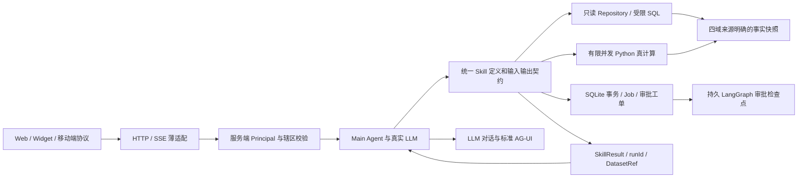

# 重构交付与剩余能力（2026-10-12）

本轮落实12任务限定重构范围：公共内核、真实计算子集、持久工作流、服务端身份与部署门禁。原54项功能没有全部完成；现有 UI 和 available Skill 不等于对应完整专业需求签收。所有业务交互统一进入 Main Agent，通过实际 LLM、真实 Skills 生成对话及 AG-UI；数据来源不参与伪造结果。

## 架构变化

事实库只读、业务库独立。查询具有 AST 白名单、行数和表数预算、辖区视图与敏感列限制。Python 子进程有限并发、超时、字节预算与取消，不因子进程返回文字而认定算法成功。每次真实执行保留运行追踪、数据来源、方法与限制；失败和不可用能力不复用旧成功视图。

旧 HTTP 路径保留为适配入口。内部数学、SQL、事务、Worker 状态机是确定性业务实现；产品功能请求必须由主线 LLM 选择并执行 Skills。登录、主题、地图平移缩放、健康检查、事件传输、已授权文件下载是基础协议操作。

## 已交付与实际边界

| 范围 | 已交付 | 当前边界 |
|---|---|---|
| 主线与公共操作 | 多工具调用、无工具 LLM 汇总、SSE、AG-UI、会话、技能管理、人工采集、查询、实际 Markdown 报告与 CSV 字节导出 | LLM 故障有限重试后失败；格式纠正也是实际模型请求，无固定答复兜底。PDF/视觉识别未实现 |
| 病媒 | 真实 AR/GBDT 捕获预测与滚动回测、方法分组、真实记录生测摘要、PCR 两项关联、KMeans、IDW、近似圆形条件 Poisson 扫描 | 捕获/记录不是标准密度；训练拟合不是未来效果；没有完整 ARIMA/LSTM、完整 SaTScan、验证过的传播模型、Probit/基因演化/完整专业流水线 |
| 食源性 Mock | 真实 SQL 汇总、暴露候选计数、cgMLST 等位差异与单链接候选簇 | 无未暴露对照不能声称 OR；候选簇不是确诊源头；病原类型预测/LSTM未实现 |
| 环境 Mock | 实际指标汇总、日历滞后 Pearson、用户提供明确权重时 Moran | 不虚构河网/管网邻接和溯源；DLNM/场景专业模型、OCR标化/场所评级/离线能力未完成 |
| 慢病 Mock | 实际月死亡数、区县中心 DBSCAN、罕见码/伤害聚集候选、死因经验质控与编码候选 | 无个人精确位置；簇不是风险；无 ARIMA/人口率、完整 ICD 规则引擎/风险GBDT/寿命表/ROI/真实完整Apriori |
| 工作流 | SQLite Job/lease/有限重试、实际主线分析、持久审批恢复、幂等工单与站内通知、实际人工采集复测证据 | 仅本地工程工单闭环；专业政策须另验收。外部短信/APP/机构流程没有伪造送达 |
| 身份与授权 | 本地账号、scrypt、服务端会话、Origin/CSRF、域/角色/辖区/所有权、敏感列、独立专业审批权限 | 无机构 SSO；生产默认 pilot，无默认账号；必须先配置组织用户再试点 |
| 部署 | 四版本校验迁移、单镜像四域任意端口、只读来源、readiness、Worker、依赖锁、CI配置、业务/检查点备份恢复 | SQLite 仍是当前驱动，PostgreSQL/Kingbase尚未交付；资源并发限制是每进程，不是集群性能承诺 |

完整可调用/不可用清单见 [final-capability-inventory.json](refactor-evidence/final-capability-inventory.json)。其中 available 仅代表被限制的方法可以执行，不能推导为完整原需求完成。未训练或未接入的能力返回 CAPABILITY_UNAVAILABLE。

## 验证证据

- [最终门禁](refactor-evidence/final-review-full-gate.log)：lint、TypeScript、125项TS、29项独立科学、19项集成、44项兼容回归通过；源事实数据库未变化。
- [最终镜像构建](refactor-evidence/final-reviewed-docker-build.log)：Next生产构建、Node/Python运行时与Worker打包成功；锁定镜像 digest 和依赖。
- [四域真实 LLM / Skill / AG-UI](refactor-evidence/t12-final-live-runs.json)：按 runId 保存实际结构化结果、工具参数、方法、来源与模型对话。初始 JSON 失败另存 [失败记录](refactor-evidence/t12-initial-live-runs.json)，不能删去失败后声称一次通过。后续病媒包含一次非法额外参数的失败和有效重试，保留原运行历史，再次严格参数调用成功。
- [最终镜像实际认证多人流程](refactor-evidence/final-live-cross-user-approval.json)：不同用户审批基层提交任务，Worker实际分析有同runId技能证据，通知首次投递1、重复0；未绕过复测等待。最终容器[就绪与存活](refactor-evidence/final-reviewed-readiness.json)。
- [试点 bootstrap前](refactor-evidence/t12-pilot-before-bootstrap.json)、[bootstrap后](refactor-evidence/t12-pilot-after-bootstrap.json)：缺源不造数、缺账号不就绪、明确初始化后就绪、匿名401。
- [实际业务与检查点恢复](refactor-evidence/t12-real-backup-restore.json)：停止写入后备份并核对18表，包含实际分析任务和已审批工单，不仅使用手工fixture。
- CI合成环境本地执行 [TS](refactor-evidence/final-ci-refactor.log)、[科学](refactor-evidence/final-ci-scientific.log)、[集成](refactor-evidence/final-ci-integration.log)；GitHub远端workflow尚未推送运行，不能声称远端CI已通过。

本次真实病媒浏览器样例：郑州市诱蚊灯法、asOf=2025-11-11、horizon=1、AR，1287条记录、8个历史逐月预测对，MAE=3.01236、RMSE=3.96789、R²=0.30380、sMAPE=32.22158%。低于基线 MAE=4.02777，但没有达到10% sMAPE目标，也不能替代标准密度要求。全快照分组结果和独立数学验收见 [T8报告](t8-vector-acceptance.md)。

Mock样例真实计算：食源性8株、阈值5、1个候选簇，内部最大等位差4；环境660记录/11厂，缺配对日期返回null，未锁定源头；慢病509条死亡记录、2个区县中心簇/7噪声点和需复核罕见码候选。上述只能验证工程与方法，不能签收三域真实精度。

最终独立审查、修复与实施裁决另见 [最终审查记录](最终审查与实施裁决.md)。阶段报告 T6/T8/T9/T10/T11 是当时证据，后续任务状态以本文及最终审查为准。

## 后续优先级

1. 先完成组织用户、辖区、专业审批政策和受控试点运维配置，验证真实多人工作流；不把工程工单等同正式风险处置标准。
2. 对病媒确定采样投入计量、目标密度分母、时间缺测政策及真实回测标准；按实际误差补齐模型，不设置精度地板。
3. 三个Mock域接入真实、脱敏、质量可核查数据，补齐河网拓扑、人口分母、未暴露对照、专业规则/标签，再做外部效果验收。
4. 按独立需求建设完整模型、OCR/视觉、PDF、离线、SSO、外部通知及生产数据库驱动，逐项签收；保持未实现状态显式可见。

成果保存在独立 codex/cdcbuddy-refactor 分支，尚未合并、推送或发布到主项目。用户审阅本轮交付后再处理集成。
