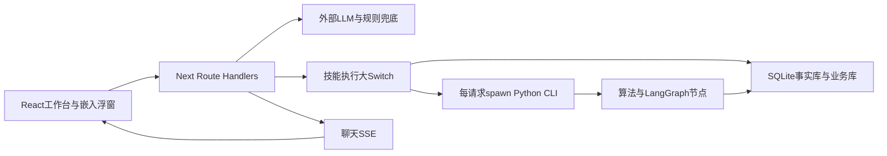

# Agent-CdcBuddy 项目成果与架构评估报告

> **交互约束补充：**用户进一步要求：Mock仅限输入数据；所有功能必须实际执行，且通过主线Agent的LLM+Skills返回对话结果和AG-UI。不得保留固定成功演示或关键词规则绕过LLM。以修订计划v3为准。

**日期：2026-10-12（北京时间）｜状态：供审阅，未执行重构**  
**代码基线：`1838c1b23c83feff4826d54f177f4c4fdb380781`｜项目版本声明：2.0.0**

> **2026-10-12补充说明（用户确认）：**病媒数据库为真实数据；食源、环境、慢病伤害三个数据库为Mock数据；RBAC尚未实现。三域Mock是当前研发数据底座，不作为缺陷；固定输出、未训练模型与数据驱动计算不足仍按原证据评估。RBAC改列待建设能力，原文中相关风险描述仅说明尚不具备生产访问隔离，不表示已有RBAC实现。实施顺序及范围以[修订重构计划](../../superpowers/plans/2026-10-12-cdcbuddy-refactor-plan.md)为准。

## 1. 总体结论

项目已形成覆盖四个疾控领域的交互原型与部分可运行的分析、持久化能力；病媒领域的基础分析实现相对扎实，四领域工作台、技能注册、生成式卡片、会话存储、流式问答、嵌入式组件和容器部署骨架已有较多可复用成果。

**当前适合演示、需求验证和受控研发验证，尚不具备按文档直接认定“54项功能全部完成、算法效果达标、全链路无Mock、生产级交付”的证据。** 主要短板并非界面数量，而是：

1. 服务端身份、角色、辖区、会话归属和自定义技能私有性没有形成可信的授权边界。
2. 数据库查询、真实数学计算、经验规则、固定样例与随机输出混在同一成功响应中，使用者难以判断结果来源。
3. 部分“LSTM、随机森林、DLNM、DBSCAN、贝叶斯网络”等名称与实际实现不符，准确率和效果指标存在硬编码。
4. 自动巡检、通知送达、复测核销、人工审批恢复、移动采集审核入事实库等业务链路仍有断点。
5. 现有回归可以通过，但其断言范围不足以证明需求完整性、算法正确性与上线可靠性。

**建议保留现有技术栈，采用“模块化单体 + 独立计算Worker + 统一数据与事件边界”渐进重构。** 先修结果可信性与权限，再整合业务内核，最后补齐算法和功能；不建议立即拆成大量微服务或全面重写。

## 2. 范围、依据和评估方法

### 2.1 文档口径

以 `plan/人工智能-四智能体-功能清单.md` 的 **No.23—76共54项**作为业务验收主表；README、需求对照教程、算法规范、技术架构说明、四领域扩展方案、移动API指南、Text2SQL指南、Skills指南、嵌入指南、生产数据库迁移指南、部署运维手册以及版本计划/成果说明作为实现声明与设计背景。

文档有冲突时，优先保留原始需求编号和原始约束，不将后续注册表的编号映射当作需求变化。例如：No.56是环境监测报告，No.58是环境移动助手；测试套件却把No.56标为处置建议，并把No.58混成报告与移动端。慢病技能注册表也存在No.64/66、No.70/71等映射与实际功能不一致的情况。

本轮重点核验仓库内可执行实现及Markdown需求。未对技术白皮书DOCX做逐页排版审阅，也未验证仓库外系统、真实机构业务流程或专业标准条文本身的有效性。文中的“≥98%”“≥95%”“≥80%”均按项目需求阈值处理，不认可代码中的“国家标准达标”文字作为认证。

### 2.2 实施方式与限制

- 静态追踪：工作台 → 流式/非流式API → 技能执行 → Node/Python边界 → 算法 → 数据库 → 卡片/存储。
- 动态核验：在临时副本中重跑四领域回归，原业务数据库和旧测试报告保持不变。
- 只读反例：检查空数据、未知城市、未知死因、无效分子向量和统计口径。
- 本轮没有调用外部LLM、短信、APP推送等收费/外部服务，没有执行Docker构建、生产部署、数据库迁移或重构。
- 未进行真实浏览器逐卡验收、端到端HTTP权限攻击、负载/故障注入、长期巡检、真实数据外部验证；涉及这些效果的结论明确保留为“未验证”。
- 本地TypeScript通过依赖现有安装环境，不等同于干净安装、Next生产构建或容器成功。

证据入口：[源码定位索引](evidence/source-evidence.md)、[行为探针输出](evidence/behavior-probes.json)、[探针脚本](evidence/behavior-probes.py)、[本轮回归汇总](evidence/replayed-suite-summary.json)。

### 2.3 分类口径

| 分类 | 定义 | 不能推导出的结论 |
|---|---|---|
| 部分实现（P） | 已有实质查询、计算或持久化子链路，但原始需求仍有缺项、错误或未验证约束 | 不等于生产验收完成 |
| 演示为主（D） | 核心需求输出主要来自固定样例、经验模拟或预填结果，真实子能力不足以完成核心目标 | 不等于真实模型已上线 |
| 缺少核心实现（M） | 有数据/文档/通用界面，但未找到对应专用业务链路 | 不证明仓库外系统不存在该能力 |
| 已验收（A） | 需求链路完整且效果阈值有独立证据 | 本轮没有将任何一项列入A |

**本表按“整项需求”分类，不否定某项内部已经完成的子功能。未列A不代表代码没有价值，表示当前证据不足以完成整项签收。**

## 3. 已完成成果及可复用资产

| 成果 | 当前证据 | 可保留部分与边界 |
|---|---|---|
| 四领域工作台与配置 | `agent-profile.ts`、按领域筛选的技能注册表、四端口启动脚本 | 可复用布局、领域提示词与卡片配置；目前主要是共享实现的领域入口，不能等同于四个独立自主Agent协作系统 |
| 技能到生成式UI链路 | `registry.ts`、`server-executor.ts`、`GenerativeComponentRenderer.tsx`及专业卡片 | 可保留组件资产；服务端输出需改成严格类型和版本化契约 |
| 病媒统计/分析 | SQL事实查询，AR自回归、K-Means、Apriori、简易GBDT、IDW、空间扫描 | 有实质计算；算法名称、采样口径、数据时窗、效果验证需修正 |
| 食源分子相似度网络 | 汉明距离、Kruskal MST与分组 | 可复用计算骨架；数据缺失处理、位点分母、阈值适用条件和供应链溯源未闭合 |
| LangGraph科学流水线 | `satscan_lstm_pipeline.py`真实`compile()`和`invoke()`；动态流程与巡检也有StateGraph | 不是全是假框架；可保留节点编排。持久化检查点、真实人工中断和恢复未实现 |
| 会话与消息存储 | 业务库事务写入，视图快照、消息与领域字段，历史抽屉 | 持久化是真实实现；客户端提交身份、归属校验、消息幂等和附件生命周期需完善 |
| 流式交互 | SSE路由、客户端解析器、ThinkingProcessCard、上游超时配置与回归 | 可保留流式产品体验；聊天SSE不能证明后台告警已实时推送 |
| 自定义技能 | 创建、编辑、删除、SQL与领域持久化 | 已有扩展入口；私有技能授权、SQL统一校验与按领域执行有缺陷 |
| 移动采集 | 三个JSON API、业务提交表、简单逻辑校验 | 可保留提交能力；视觉识别是模拟，审核入事实库、离线缓存与扫码缺项 |
| 部署工具 | Docker多阶段、standalone、非root用户、健康检查、持久化路径、PowerShell远程脚本 | 工程基础可保留；领域运行配置、事实库准备与生产禁止自动造数据需要统一 |

本地事实表数量：病媒监测 **48,530**、PCR **7,336**、抗性测定 **365**；食源病例 **3,292**、分子分离株 **432**；水质 **4,662**、污水 **9,300**、空气气候 **3,600**；死亡 **8,500**、慢病 **12,000**、伤害 **5,000**。因此“5.6万病媒捕获事实”与当前`fact_monitoring`单表口径不一致，可能混合统计了监测与PCR等事实，应明示分表和来源。

**数据库内存在记录只证明存储和读取真实，不证明记录来源是真实监测。** 仓库提供食源、环境、慢病Mock生成脚本，容器入口会在文件缺失时调用它们。用户已确认病媒库为真实数据、其余三域为Mock；本轮未独立核验外部采集过程。

## 4. 整体架构评估

### 4.1 实际架构

实际上是**一个共享代码库、多个领域进程/容器入口**。文档里“领域四智能体”和“病媒领域内监测/抗性/风险/处置四职责”是两套不同概念，当前没有统一Agent身份、任务消息协议、跨领域状态隔离和协作审计，不能把四端口部署视为完成跨域多智能体协同。

### 4.2 各层判断

| 层面 | 优点 | 问题与影响 | 优化方向 |
|---|---|---|---|
| 前端 | 专业卡片多，主题与GIS组件可复用 | `page.tsx`856行、`EmbeddedWidget.tsx`605行，各自维护聊天与会话流程；状态保存和恢复与展示耦合 | 共享工作台控制器、聊天状态机与会话Repository；卡片只消费契约 |
| API/BFF | 流式与非流式接口存在，上游超时已抽取 | dispatch488行、stream832行，统计/提示词/工具执行/解释逻辑重复；域默认值不统一；首个tool调用为主 | 单一DispatchService；HTTP和SSE只负责协议转换；有限多步工具循环 |
| 技能层 | 注册表表达领域与角色需求 | registry1227行、executor1222行；同一ID别名、角色过滤、任务名、UI类型散落；`any`绕过检查 | 领域插件定义绑定schema、权限、executor、UI映射与需求ID |
| 编排层 | 真实StateGraph调用已存在 | 另有`langgraph_app.py`重复中枢，部分节点只写日志；真正执行图也没有checkpointer/interrupt | 保留实际使用图，合并重复入口；显式审批节点与恢复协议 |
| 计算层 | Python适合现有科学计算 | 每次spawn，重复导入科学库；无子进程超时、并发上限、取消或输出大小限制；有本机绝对路径 | 先封装可限流的Runner，再分离长驻Worker与作业队列 |
| 数据层 | 事实库读写分离意识，业务事务已有 | DAL仅覆盖病媒一部分；Python直接连库，领域路径固定；Kingbase适配器全方法抛错 | 分领域Repository，统一配置、迁移与只读分析视图；逐步实现生产驱动 |
| 安全 | UI角色矩阵和readonly事实库是基础 | 服务端没有可信身份/归属/辖区验证；公众前端过滤可绕过；私有技能SQL可被返回 | 服务端认证、角色+辖区+资源归属授权；不可由请求参数授予权限 |
| 可观测性 | 有日志、异常捕获与调用记录 | 没有统一trace、作业状态和可信执行元数据；失败转成功/默认数值掩盖异常 | 明确结果状态、来源、版本、耗时和审计事件；错误可见 |
| 部署质量 | 多阶段镜像、非root、挂载业务库 | 自动Mock、共享SQLite启动迁移、健康检查仅首页；运行时域与客户端构建配置可能不一致 | 演示与生产显式模式；单次迁移Job；readiness检测依赖与领域 |

### 4.3 关键发现和优先级

**P0：首个真实数据试点前必须解决。P1：业务可靠性或功能完整性关键缺陷。P2：维护成本与进一步优化。** 下列为静态已证实或只读复现问题；风险影响不代表已发生外部入侵或真实业务损失。

| 编号 | 优先级 | 发现与根因 | 影响及建议 |
|---|---|---|---|
| F01 | P0 | `/api/skills`直接按skillId执行；会话详情、修改、删除按ID操作，没有服务端认证和归属校验。角色来自客户端，Rbac默认省管理员 | 资源访问和业务写入缺少可信边界。所有入口统一认证；执行前授权；SQL强制辖区和敏感列控制 |
| F02 | P0 | 固定/模拟结果走SUCCESS链路，失败fallback补数值；Mock初始化可进入容器启动 | 用户无法区分演示与真实判断。生产默认禁止demo数据；结果包含dataOrigin、executionStatus、qualityFlags；无数据必须返回NO_DATA |
| F03 | P0 | LSTM随机初始化权重，无训练/加型流程；质控0.992、编码0.965、慢病0.835硬编码；水质RF重要性、DLNM、Moran、ROI等固定 | 不能证实科学效果，模型名称产生误导。先改实际方法声明和指标来源，再独立基准验收 |
| F04 | P0 | 未知死因无字典命中仍默认急性心肌梗死与98.2%置信度 | 只读反例已复现。未知输入必须拒绝自动编码并进入复核，返回规则覆盖范围 |
| F05 | P1 | 水质`pass_rate`已是百分数，输出再乘100；名称max的CR/HQ实际来自均值 | 郑州337条样本显示9496.0%，max指标与定义错位。统一单位、比例与聚合契约并加独立断言 |
| F06 | P1 | 慢病死亡/伤害/寿命表多个函数接收city却未加SQL条件；病媒预警筛选为空时回退其他预警，severity无命中时保留原列表 | 返回区域与声明不一致。区域条件成为必经Repository参数；无命中不能扩大范围 |
| F07 | P1 | LSTM按日期升序LIMIT60取最早数据，预测起点默认2022；AR与食源预测强制R²下限，误差≤9.2%写死 | 结果时窗和效果指标不可信。严格asOf时间截断、最近窗口、滚动回测、输出实际指标 |
| F08 | P1 | 巡检仅单次invoke；queue节点组装字典而未真实publish；push_status直接写SENT；无短信/APP适配链路 | 尚不是7×24守护、事件驱动或通知送达。增加scheduler、持久化任务、outbox、provider回执、重试与幂等 |
| F09 | P1 | 工单核销固定写3.8/0.03/15；默认ticket固定ID；没有复测记录与时间约束；HIL只有标记无中断 | 展示闭环不能证明业务闭环。按真实复测证据转状态，审批持久化并恢复图，唯一ID及审计 |
| F10 | P1 | SQL防护只有SELECT前缀和关键词；已有LIMIT不限制上限，表/列/辖区无完整允许列表；自定义技能默认分支总走病媒provider，异常伪造“执行完成” | 只读库可阻止常见写操作，但无法完成数据隔离/查询成本控制。统一安全查询网关，域、列、行与成本约束 |
| F11 | P1 | 移动识别不消费图像直接固定返回；record不强制调用validate，0用`||`替换；业务待审表未形成入事实库流程，却返回syncToSpatialMap=true | 识别、数据质控与地图同步声明不成立。统一采集命令校验、0值语义、审核批准/驳回、入库事件 |
| F12 | P1 | PostgreSQL/Kingbase pool=null，全部方法抛错；Python和业务库绕过DAL | 配环境变量不能完成生产迁移。实现驱动、全域schema迁移、双库对照与恢复演练 |
| F13 | P1 | cgMLST按min长度比较，无效空向量距离为0；相似度固定30位点分母 | 可能把无效输入认作完全相同。有效位点覆盖检查，缺失处理，版本与分母显式 |
| F14 | P1 | 容器同镜像运行不同AGENT_DOMAIN，NEXT_PUBLIC域未作为build arg；默认端口和BFF域有分歧 | 自定义公网端口下客户端域可能回落病媒；仅静态风险，本轮未容器复现。由服务端提供唯一runtime profile并验证四容器 |
| F15 | P2 | 两套dispatch和两套工作台重复；桥接返回T泛型而无运行校验，宽泛异常吞掉；LLM工具只取首项为主 | 修改容易遗漏分支与字段错配。统一服务和schema；支持有限工具循环与明确错误 |
| F16 | P1 | 回归测试含固定样例、直接SQL模拟、assert_true(True)，缺真实HTTP鉴权与模型独立基准；lint首次进入配置交互；未发现仓库CI工作流 | 44/44是现有断言通过，不是需求完成或100%覆盖。建设分层质量门禁并重写验收证据 |

具体行号、关键表达式与文件链接见[源码证据索引](evidence/source-evidence.md)。

## 5. 54项功能实现完整性对照

每行的结论同时考虑核心行为和原始功能边界。效果阈值没有真实验证集时统一视为未验收，不依据固定输出判定达标。下表文件名均为仓库内实现定位。

### 5.1 病媒与宿主动物（No.23—35）

| No. | 需求 | 状态 | 已实现与定位 | 与预期的差距／验收补充 |
|---|---|---|---|---|
| 23 | 种群动态，未来3个月，误差≤10% | P | `population_dynamics.py`真实SQL、AR递归、季节因子与区间 | 不是完整ARIMA/训练LSTM；R²截断、误差声明固定；缺独立时间回测与气象真实未来输入 |
| 24 | 优势种聚类与分布 | P | `species_clustering.py`构成、Shannon和聚类，对应图表 | 缺多区域/稀疏样本基准与空间分布端到端验证 |
| 25 | 抗药性预测与方案 | P | `resistance_ml.py`查询LC50、死亡率分段分级 | 是规则分级而非训练预测模型；LC50读取而非Probit估计；概率固定，未知药剂/地理泛化未验证 |
| 26 | 病原高危组合关联挖掘 | P | `pathogen_apriori.py`有查询与关联计算 | 缺宿主分布充分集成、外部基准、支持度/显著性业务验收 |
| 27 | 实时动态预警≤15分钟，街道下钻 | P | `spatial_interpolation.py`IDW、地图与预警对象 | 非完整实时数据事件链；空筛选兜底可污染范围；街道级观测覆盖和响应时限未测 |
| 28 | 分级系统/短信/APP推送 | P | executor保存业务预警事件 | SENT直接写库，无实际通道送达；缺收件人矩阵、重试和回执 |
| 29 | 处置、进度、反馈解除 | P | 工单创建/状态更新、UI按钮、持久化 | 固定复测值与默认ID；缺真实复测、权限、核销预警原子事务与督办 |
| 30 | 气象地理GBDT未来1—2个月 | P | `density_gbdt.py`简易梯度提升树桩与特征计算 | 有真实计算，但模型简化、地理/降雨特征不足、forecastMonths完整作用需验收；无泛化证据 |
| 31 | 密度—病原—暴露关联风险 | P | `transmission_risk.py`加权指数和SQL | 人口/气候权重固定，不按疾病过滤全部PCR；零阳性被默认1替代，空城市仍评分；未校准 |
| 32 | 用药频率+贝叶斯基因1年预测 | D | `resistance_evolution.py`死亡率反推和经验选择压递推 | 固定fallback、OR筛选扩大样本、没有基因与用药频率数据驱动贝叶斯网络；按年两步与12月口径不符 |
| 33 | 文本/语音知识问答≤2秒 | P | LLM路由、Text2SQL、业务标准库LIKE查询 | 非向量RAG；整句LIKE命中弱、固定fallback引用未经检索；语音入口与2秒SLA未验证 |
| 34 | 用户驱动专题分析与导出 | P | 聚合报告、部分归档、打印/Markdown | 全省统计与城市标题混用；固定季节结论/99.8%完整率，失败补指标；导出是浏览器打印，格式与图表验收缺证据 |
| 35 | 移动图像识别、自动填报、质控 | P | API、提交入业务库、简单规则与仿真UI | 图像不参与推断；上传可绕过规则、真实审核入库未连通、识别模型未接 |

### 5.2 食源性疾病（No.36—41）

| No. | 需求 | 状态 | 已实现与定位 | 与预期的差距／验收补充 |
|---|---|---|---|---|
| 36 | 时空聚集识别、自定义动态规则 | P | `outbreak_scanner.py`聚集计算、病例查询卡片 | 缺增量运行、完整规则管理与阈值校准；需扰动病例时窗和症状暴露联合验收 |
| 37 | LSTM区域/病原预测与扩散风险 | P | `risk_forecast.py`真实病例聚合与AR最小二乘预测 | 非训练LSTM，R²截断；天气/人口/交通扩散与未来病原类型预测不完整 |
| 38 | 知识图谱+供应链+基因溯源 | P | cgMLST距离/MST与食品归因 | 是相似度网络子能力；未见完整供应链知识图谱/因果传播链；无效向量可误判同源 |
| 39 | 事件处置与历史案例匹配 | D | executor固定高校事件、流程和94.2%案例相似度 | 未由实际clusterId驱动，也无真实历史检索、事件派工和送达闭环 |
| 40 | 实时热力、暴发趋势、TOP10与钻取 | P | 病例表、聚集卡片、食品排行、领域初始视图 | 分散卡片不等于实时指标大屏；数据一致性、联动下钻和实时刷新未验收 |
| 41 | 周/月/暴发专题报告导出 | D | executor返回固定专题报告与通用打印卡片 | 病例、时窗、事件参数未动态汇总；无周期任务和真实模板归档闭环 |

### 5.3 环境健康（No.42—58）

| No. | 需求 | 状态 | 已实现与定位 | 与预期的差距／验收补充 |
|---|---|---|---|---|
| 42 | 图片/PDF OCR、交互与API | D | `skill_env_ocr_entry`固定字段和置信度卡片 | 未处理上传文件，未找到对应真实OCR服务或图片/PDF提取链路 |
| 43 | 缺失/异常处理、单位编码标化 | M | 有环境表与固定OCR展示 | 未见独立可运行批处理/规则管道、填补溯源与单位编码映射 |
| 44 | RF水质致癌/非致癌评估 | P | `water_rf_kriging.py`读实测指标和库中CR/HQ聚合 | RF重要性硬编码、未训练/加载RF；已有风险值读取不等于风险模型，百分数与max错误 |
| 45 | LSTM水质趋势、乡镇热力 | D | 水厂坐标点展示，名为krigingGridPoints | 复制观测点而非Kriging网格，未见水质LSTM与乡镇趋势数据链 |
| 46 | 污水—医院Pearson滞后 | D | `sewage_lag_tracing.py`读取两序列 | 相关曲线固定6天0.912，未由序列计算；无日期对齐/显著性实际检验 |
| 47 | 管网GIS空间溯源 | D | 固定上游汇水区和管网卡片 | 未见真实管网拓扑搜索或空间聚类计算，换城市仍返回金水区 |
| 48 | 公共场所环境—健康映射 | M | 有80条公共场所检查表，测试统计行数 | 无专门健康效应映射服务/技能或效果验证 |
| 49 | 多维卫生动态评级 | M | 公共场所基础字段与查询可用 | 缺管理/人员/公示/禁烟/设施等多维计分、等级规则和维护接口 |
| 50 | 活动模式PM2.5暴露与门诊峰值 | D | `air_climate_dlnm.py`当前空气与门诊数据 | DLNM曲线固定，无活动模式暴露整合和拟合预测 |
| 51 | GBDT热浪死亡影响、提前72h | D | 当前温度/AQI规则判断与固定三日序列 | 未训练/加载GBDT，未接真实天气预测或死亡结局数据；提前量未验证 |
| 52 | 水—土—作物跨介质污染链 | P | `river_chain_autocorr.py`各介质浓度聚合 | 真实均值但链路解释/比例固定，因子传递估计、时间空间关联与效果待验证 |
| 53 | 肝癌空间自相关集聚 | D | 固定Moran's I=0.428、Z=4.15、热点 | 未计算空间权重矩阵和置换检验，未独立估计环境—健康响应 |
| 54 | 阈值/ARIMA趋势/联动触发 | P | 现有超标字段与领域工单入口 | 静态预警与人工触发为主，缺阈值/趋势/联动的常驻规则事件链 |
| 55 | 水/空气/气候干预建议推送 | P | 水质建议和环境处置持久化 | 多为固定建议，自动精准匹配/真实分级通知及复测证据不完整 |
| 56 | 日周月报告、自定义模板与看板 | M | 有通用打印卡片和环境查询UI | 未找到满足本项的领域报告生成、周期任务及模板管理链；现有测试编号错配 |
| 57 | 污染源关闭政策情景推演 | D | `scenario_simulation.py`按减排比例缩放固定系数 | 未用源清单、扩散模型和因果健康模型；应标“假设计算”并展示假设和不确定性 |
| 58 | 扫码、照片、离线缓存、任务追踪 | D | 通用移动仿真和病媒API可展示 | 无环境专用采样schema、离线队列、冲突同步、任务生命周期；测试无条件通过 |

### 5.4 死因、慢病与伤害（No.59—76）

| No. | 需求 | 状态 | 已实现与定位 | 与预期的差距／验收补充 |
|---|---|---|---|---|
| 59 | 逻辑/缺失/重复检出≥98% | P | `death_cert_qc.py`性别年龄和根本死因规则 | 检出率99.2%固定、状态标签参与异常判定；缺重复/缺失覆盖与独立标注集 |
| 60 | NLP ICD-10准确率≥95%，分类标准化 | P | `icd10_nlp_inference.py`关键词字典匹配 | 96.5%固定，未知输入默认心肌梗死；缺真实NLP评测、分类覆盖和版本标准化 |
| 61 | 知识图谱根本死因推理 | D | 返回推理步骤文本与字典命中 | 无完整图谱/因果选择规则；文本步骤不是推理正确性证据，不能宣称替代人工编码 |
| 62 | ARIMA死亡趋势+DBSCAN空间 | D | `mortality_cluster_dbscan.py`月统计与地区排序 | 固定增长率预测、按名次分Cluster，非ARIMA/DBSCAN；人口分母口径不合理 |
| 63 | 短期≥3同类罕见死因自动标记 | P | SQL GROUP BY/HAVING≥3 | 无真实短期滚动窗口/增量触发；未过滤城市，“两周内”文字与SQL不一致 |
| 64 | 个体及群体发病预测≥80% | D | `chronic_risk_gbdt.py`读预填风险值，汇总队列 | 83.5%与GBDT权重固定；targetDisease未实质筛选；无个体输入预测、训练/外部验证 |
| 65 | 并发症关联规则 | D | 固定三条Apriori规则卡片 | 未从队列挖掘支持度/置信度/Lift |
| 66 | 高危筛查清单与成本效益 | D | `lifetable_4q70_roi.py`固定人群规模与ROI | 非实际高危名单；费用/收益缺参数来源、模型与敏感性分析 |
| 67 | 伤害类型及时空聚类 | P | `injury_tree_attribution.py`类型构成和TOP5 | 类型聚合是真实的；年龄/季节/时段聚类未实现，城市筛选未落实 |
| 68 | 决策树诱因分析 | D | 固定75.4%等归因树内容 | 无训练/推断树，不应将关联输出命名因果归因 |
| 69 | 同场所短期≥5自动聚集与溯源 | P | SQL同场所分类HAVING≥5 | 先筛is_cluster=1，依赖已有标记；无短期窗口、全量自动发现和实际溯源 |
| 70 | 阈值/LSTM/关联预警 | P | 慢病预警配置和处置入口 | 无完整LSTM/多因素实时事件生成，静态预警与工单不能替代预警模型 |
| 71 | 按风险层级推送至机构并附依据 | D | 静态领域预警和显示文本 | 无真实收件人路由与通道回执，不能验收送达 |
| 72 | 周/月/年三类监测报告 | P | SQL死因顺位/YPLL、伤害TOP5等统计 | 周期调度、完整慢病趋势/热力与动态报告装配不全；4q70固定城市值 |
| 73 | 自定义模板管理与固定格式导出 | D | reportExportReady字段和通用打印 | 未实现模板生命周期及Word文件生成；字段声明不是文档导出 |
| 74 | 高死亡病种/不明死亡干预 | P | 规则建议与慢病业务工单 | 固定事件，缺不明死亡分诊、专业复核和真实预警关联 |
| 75 | 肿瘤/心脑血管人群建议推送 | D | 固定筛查及慢病建议 | 无实际人群清单联结与推送闭环 |
| 76 | 社区儿童跌倒/道路交通干预 | P | 伤害统计和规则指导 | 存在建议子功能；社区/路段精准匹配与实际干预记录不全 |

### 5.5 分类汇总和效果判断

| 领域 | 需求数 | 部分实现P | 演示为主D | 缺核心实现M | 本轮已验收A |
|---|---:|---:|---:|---:|---:|
| 病媒 | 13 | 12 | 1 | 0 | 0 |
| 食源 | 6 | 4 | 2 | 0 | 0 |
| 环境 | 17 | 4 | 9 | 4 | 0 |
| 慢病伤害 | 18 | 9 | 9 | 0 | 0 |
| **合计** | **54** | **29** | **21** | **4** | **0** |

29/54（53.7%）表示“已有实质子链路的需求占比”，21/54（38.9%）表示“核心仍为演示的需求占比”，4/54（7.4%）表示“缺少核心实现的需求占比”。**这些比例不是功能完成率，不按半完成折算为虚假的总完成百分比。**

实现效果总体判断：

- **产品呈现**：具备广覆盖的可演示交互资产；视觉质量和逐卡交互效果尚未本轮浏览器验收。
- **基础业务执行**：SQL统计、部分算法、会话和业务存储真实可运行，但边界条件与业务闭环不完整。
- **专业科学效果**：尚不符合文档所宣称的“全部模型真实且指标达标”；部分核心输出已确认固定或错误。
- **生产适用性**：服务端授权、结果可信性、通知闭环、持久作业与生产数据库驱动存在上线阻断项。

## 6. 扩展能力与文档一致性

| 文档声明/能力 | 当前事实 | 结论 |
|---|---|---|
| “全链路无Mock、100分验收” | 视觉API、OCR、食源报告、DLNM等固定输出；启动脚本可自动生成Mock | 原结论应撤回，改成分项证据说明 |
| PyTorch双向多变量LSTM未来6个月 | NumPy前向随机Cell，主路径7天；requirements未列torch | 名称/框架/周期不一致；存在计算不等于已训练模型 |
| SaTScan时空圆柱/Poisson/Bernoulli/999次 | 月度聚合后空间圆窗、均匀点位期望、默认99次置换；缺完整时间窗和Bernoulli实现证据 | 可称“空间扫描原型”，不能直接等同完整文档能力 |
| 7×24定时+事件双轮守护，Redis队列告警SSE | 单次StateGraph执行；queue节点仅输出通道字典；聊天SSE存在 | 守护调度与实际消息链未交付 |
| Checkpointer、人机审批断点 | 图compile无持久化checkpointer；requires_hil只是结果字段 | 尚不能中断/批准/跨进程恢复 |
| 一键PostgreSQL/Kingbase迁移 | 有DDL文档和占位adapter；无可用pool和完整领域/业务驱动 | 属设计准备，不是已适配 |
| 全量RBAC、API及模型100%测试覆盖 | 存在直接SQL模拟和无条件通过；没有正式覆盖率度量 | 通过率不能作为覆盖率 |
| 对话式扩展技能严格按域隔离 | 数据表有domain；默认执行分支却固定病媒provider，private无owner过滤 | 注册持久化有成果，隔离未完成 |
| 嵌入浮窗 | React组件、脚本SDK、独立会话逻辑存在 | 有真实资产；跨域认证、宿主CSP/CORS、多域端口与会话归属需联调 |
| OpenAPI/JWT/限流/熔断/统一TraceID/K8s/RAG | 有REST路由和部分超时；未找到完整配套实现 | 应分别标规划、部分实现、未验证，避免架构图当成果图 |

## 7. 本轮验证结果与证明范围

| 验证 | 实测 | 能证明什么 |
|---|---|---|
| `tsc --noEmit --incremental false` | 退出0，见[typecheck.log](evidence/typecheck.log) | 当前安装环境下TS类型检查通过；any和动态payload不提供业务契约保证 |
| 临时副本四领域回归 | **44/44，退出0**，见[python-1.log](evidence/python-1.log) | 现有断言在当前数据下通过 |
| Python部署导入/业务库路径 | **2/2，退出0**，见[python-2.log](evidence/python-2.log) | 两个指定导入/临时DB路径检查通过 |
| Node超时配置回归 | **4/4**，见[timeout-tests.log](evidence/timeout-tests.log) | 超时默认值、合法/非法配置解析与变量隔离有效 |
| `npm run lint` | 进入首次ESLint配置交互，未形成已配置静态检查结果 | **不能声称lint通过**；见[lint.log](evidence/lint.log) |
| 只读行为探针 | 已复现下表异常 | 证明对应算法函数的问题，未替代完整HTTP/UI测试 |

| 反例输入 | 实际输出 | 根因定位 |
|---|---|---|
| 郑州水质337条 | `overallComplianceRate=9496.0%` | 百分比重复乘100 |
| 不存在市：种群动态 | 空trend仍有R²=0.85和相关系数 | 空数据分支固定指标 |
| 不存在市：传播风险 | 73分、较高风险 | 无数据默认值和固定人口/气候参数 |
| 不存在市：污水溯源 | SUCCESS、4个模拟样本、6天r=0.912、金水区源头 | 空数据fallback与固定相关/来源 |
| 郑州和不存在市：死亡分析 | 空间簇与趋势完全相同 | target_city仅用在返回标签，SQL未过滤 |
| 完全未知死因链 | 心肌梗死I21.9、置信度0.982、准确率0.965 | 无命中默认诊断与固定指标 |
| cgMLST空向量和3位向量比较 | 差异0 | min长度导致无比较位点仍判零差异 |

历史的16/16、44/44成果报告可以保留为历史记录，但应附注适用提交、数据来源、断言范围和本轮发现，不再作为生产验收证明。

## 8. 建议决策

优先批准配套[架构重构与分阶段改进方案](架构重构与分阶段改进方案.md)中的**阶段0—2：需求基线、可信结果与服务端边界、共享内核整理**。先选择病媒领域做完整纵向试点，验证“输入→分析→预警→审批→派工→复测→报告”，再扩展其他领域。

如果近期目标是专家演示，阶段0—1可先保留演示资产并清晰标识来源；如果目标是真实业务试点，权限、可信输出、真实复测和数据接入必须成为准入门槛。生产库与高可用部署应在业务边界稳定后推进。

本次仅新增本评估、方案及复核证据，未修改应用代码、算法实现、配置或原业务数据库；所有重构建议待用户审阅后执行。
