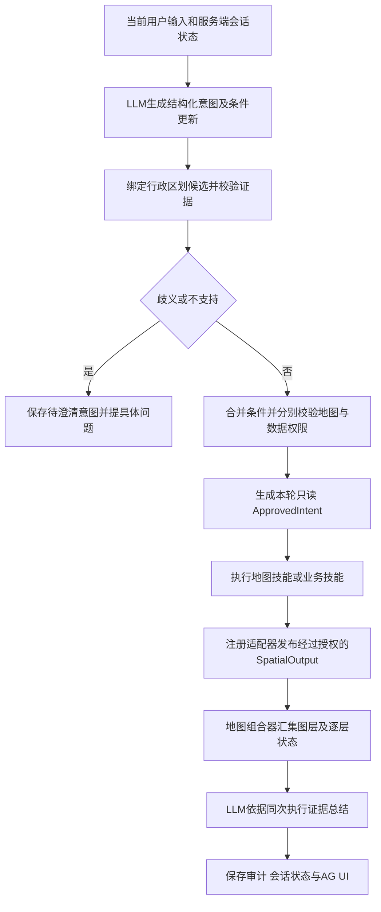

# LLM地域识别与地图能力改进方案

状态：设计方案，尚未实施。日期：2026年10月13日。

地图协作审查已补入统一空间输出、技能覆盖登记、共享画布、图层组合及专项验收。原`pointRows/spec`叠加约定由下文的`SpatialOutput`替代，覆盖非数值点位、标注、热力、插值、区域和线网。

将自然语言地域、指代和历史条件的识别交给LLM，将行政区划绑定、条件合并、权限和查询执行交给服务端。增加独立地图展示技能，使“显示河南省地图”只需要真实边界资源，不需要监测数据、年份或指标。通过统一执行范围约束所有业务技能，解决简称误匹配、历史筛选残留和SQL与工具参数不一致的问题。

“彻底解决”在工程上指消除这些问题反复出现的结构性入口，并提供可检验的失败处理；不承诺LLM对任意语言永远识别正确。模型存在歧义、来源不支持或服务不可用时，必须明确澄清或失败，不能猜测执行成功。

## 一 问题与目标

2026年10月12日22时43分，用户在郑州市2024年监测点位查询之后输入“显示河南省地图”。实际技能参数仍包含`city="郑州"`和2024年日期范围，执行结果为`NO_DATA`。同一SQL在来源库中使用“郑州”过滤返回0行，使用“郑州市”返回46行，省略城市限制返回200行并达到查询上限。该对照证明错误筛选足以解释当次空结果，200行不代表全省总量。

当前`normalizeProvinceCity`只消除部分省级文本，不能判断续问语义，也没有将城市简称绑定到规范地名。`QueryVisualization`的地图类型要求点位坐标与数值；`executeQuery`在无数据时返回空payload，`QueryResultVisualization`也不渲染空点位地图。仓库已有省、市、县边界文件，因此基础地图不应依赖业务查询成功。

目标包括：

- LLM识别“河南／全省”“郑州／郑州市”、上下级地域、简称、否定、纠正及“那里／刚才那个市”等指代。
- 每个地域、时间和业务过滤条件都说明设置、继承或清除及其证据；当前请求优先，历史不会隐式污染新任务。
- 地图视野与业务查询范围分开表达，服务端权限独立校验。
- 所有需要空间展示的技能通过统一SpatialOutput协作，在同一画布组合点位、标注、热力、插值、区域或线网，并逐层保留来源与单位。
- 监测数据为空时仍能显示本次实际加载的底图；业务不足状态保持原意。
- SQL、Python分析、导出和后台任务使用同一份服务端批准的范围。
- 通过真实模型评估和浏览器验收证明原始指令可执行，不用固定成功文字或伪造点位兜底。

首期覆盖四个领域现有查询、分析、地图、导出及后台分析入口。采集、审批、删除和身份管理仍沿用明确操作和原权限校验；不得由地域识别结果改写现场原始记录或授权写操作。

## 二 统一执行链路

自然语言对话统一经过意图阶段，不用包含“地图”或“河南”等关键词来决定是否启用。已有UI控件传入结构化操作时，直接走同一绑定和授权服务，无需让模型重新猜测按钮语义。模型识别阶段不执行SQL或写操作。

简单底图请求经过一次LLM识别、一次真实地图技能和一次LLM汇总。已确认的`map_display`意图直接绑定`skill_map_display`，无需第二个模型重新选择技能；其他业务请求继续由现有主线Agent选择实际业务技能。

## 三 LLM识别协议

### 任务与字段更新

新增`InteractionIntent`协议，核心字段如下。示例中的数值为设计约束。

| 字段 | 含义与约束 |
|---|---|
| schemaVersion | 固定`1`，AJV严格校验，禁止额外字段 |
| task | `map_display / map_with_data / map_edit / data_query / analysis / other / clarification`；map_edit只修改已有场景，不清除业务条件或重查数据 |
| relation | `new_task / continue / modify / reset`，LLM根据本轮语义选择 |
| displayRegion | 地图视野的更新，允许与数据范围不同 |
| dataRegion | 业务数据地域的更新，与显示范围分别给出 |
| time | 时间窗的更新；相对时间基于服务端配置的`Asia/Shanghai`日期解释 |
| filters | 物种、方法、病原、指标等允许字段的更新；字段白名单按当前技能定义生成 |
| mapOptions | 矢量或卫星、行政边界层级、叠加层；不允许任意样式脚本或外部URL |
| layerRequests | 图层类型、指标、来源技能候选或已授权结果引用、图层条件与组合操作；LLM不能填写真实要素、坐标和计算结果 |
| evidence | 解释所用的当前文本片段或服务端上下文引用，不保存思维链 |
| unresolved | 尚未确定的地名、指代、指标或时间，须给出具体问题 |

每个条件使用三种操作：`set(value,evidence)`、`inherit(contextRef,evidence)`、`clear(evidence)`，不能用`null`同时表示“没说”“沿用”和“取消”。引用使用UTF-16的`start/end/quote`，服务端检查`userInput.slice(start,end)===quote`；文本命中只证明引用存在，不能单独证明语义正确，仍需候选一致性和模型评估。

模型只选择本轮候选中的`candidateId`，不能自由填写`city`、行政区代码、中心点、数据库路径或权限。服务端将候选id绑定到版本化目录记录后，才生成规范名称与代码。未知地名允许输出`unresolvedMention`，禁止输出虚构候选。

### 模型上下文

识别提示词明确输入优先级：本轮用户文本、已授权的结构化操作、服务端已执行会话状态、用于语言理解的近期对话。客户端`history/viewContext/attachments`只能提供不可信语境，不是执行条件或权限来源。已授权的按钮值不能被模型扩大或改写。

服务端向模型提供当前领域、可用任务、候选目录版本、地图覆盖范围、上次已批准的条件及对应运行引用。近期文字用于理解省略和纠正，历史助手总结中的数字、地名和过滤条件不能直接成为新执行参数。

识别结果不以模型自报置信度作为放行条件。普通简称在唯一候选和明确证据下可执行；同名地名、父子冲突、否定范围不清、引用不存在或候选不足则澄清。对模糊近似地名提供真实候选，模型仍无法唯一确定时询问用户。

## 四 行政区划目录与绑定

新增版本化`config/regions.json`，每项包含`candidateId、code、canonicalName、level、parentCode、aliases、sourceRef、geometryRef、bbox、supported`。规范名称从目录取得，别名用于候选检索和语义支持，不构成硬编码自然语言路由。

初始目录结合本地GeoJSON与既有地理配置建立。现有文件分别包含1个省级feature、18个市级feature、157个县级feature；这是仓库资源数量，不代表当前行政区划完整性。GeoJSON中的`gb`保留为原来源标识，通过独立且校验过的转换生成目录代码；不得直接把任意后六位当合法代码。现有`HENAN_CITIES_GEO`中的风险标签不进入目录，也不成为地图事实。

例如，“显示郑州地图”由LLM识别为map_display并选择目录中的郑州市候选，服务端取得410100、city层级及真实bbox；“显示新郑市地图”选择county层级候选。模型即使填写另一个真实候选，也须通过引用、别名或父子指代的候选支持检查；仅“代码存在”不足以证明选对地名。特殊俗称或关系表达缺乏支持时，再进行候选消歧或澄清。

构建目录时检查代码唯一性、父子关系、几何匹配、坐标范围与来源版本。资源与名称不一致或缺少几何时标记支持状态，不能由模型补造。数据源内历史名称与边界名称不同，通过版本化`config/dataset-region-bindings.json`显式登记映射；无法确定映射时返回`REGION_DATASET_MAPPING_REQUIRED`。

候选准备先提供河南省和全部现有市级记录，以及服务端上下文中已知的县级记录。模型提出县名或目录外地名时，服务端按该实体片段检索目录，返回最多20个候选及父级关系，再让LLM判断。检索只召回候选，不自动取第一项，不通过给字符串追加“市／县／区”确定层级。

每轮识别最多2次LLM请求：一次解析，第二次仅用于候选消歧或格式纠正；两者同时出现且无法在第二次解决时结束为澄清或`INTENT_INVALID`。候选被截断且可能遗漏时标记`hasMore`，缩小父级范围或澄清，不能因为只返回一个候选而假定唯一。

“新郑市”等县级市按目录的`level`和父级绑定为区县，不因名称后缀而误填地级市。目录外地域明确告知当前覆盖范围；不得随意映射到河南省内相似名称。

## 五 历史条件继承

LLM识别本轮是在开始任务、修改上次任务，还是清除条件；服务端按下表执行合并，不自行解析中文关键词。

| 本轮语义 | 地域 | 时间与业务过滤 |
|---|---|---|
| “显示河南省地图” | 显示范围设为河南省；数据范围清除 | 清除，底图请求不查询监测数据 |
| “只看底图，不要监测点” | 无新地名时可继承上次显示范围 | 清除数据地域、时间、业务过滤和叠加层 |
| “保持刚才的数据条件，换成全省点位图” | 数据范围改为河南省并清除旧市县限制 | 明确继承上次已批准时间、方法、物种等 |
| “换成全省”且上次是监测点位查询 | 修改上次任务的地域；清除旧市县限制 | 继承上次兼容条件，需引用上次运行与本轮修改证据 |
| “郑州今年的监测点位” | 绑定郑州市；新任务不继承旧区县 | 设置本年日期窗，不继承未提及物种或方法 |
| “那里去年呢” | 从单一服务端地域上下文继承 | 修改时间；其他兼容条件显式继承 |
| “全市，不限区县” | 保留已确认城市、清除区县 | 其余兼容条件可显式继承 |
| “河南省地图上只标郑州监测点” | 显示河南省，查询郑州市 | 业务条件按明确文本或有效续问继承 |
| “排除郑州” | 对已确认地域集合做排除 | 无基准集合时先澄清，不自动扩大到全省 |

`new_task/reset`不得继承任何未明确引用的旧业务条件；`continue/modify`只有引用服务器状态且字段适用时才继承。地域变宽或变窄时，从新的区划目标重新生成整个地域范围，不能保留旧市县字符串。任务从业务图切换到底图时，数据条件固定为`clear`；相互矛盾的模型输出被校验拒绝。

“切换卫星图”“隐藏点位标签”“把这层改成热力图”等属于map_edit，保持当前图层来源与数据条件；“只看底图，不要数据”才清除业务叠加。改变一个图层的样式不产生新的业务查询，也不能触发纯底图任务的清除规则。

多地域对比使用`includeCodes/excludeCodes`集合表达，每次显式目标最多10个；省级目标以一个省代码表达。各目标独立授权，混合可访问与不可访问目标时拒绝该数据请求，不悄悄丢掉目标。排除仅从已确认基准集合中减去目标，不能产生新授权范围。

纯地图任务未给地域且无法引用服务端显示状态时，可使用明确标记的部署默认显示范围“河南省”；该默认只影响底图视野，不成为默认业务查询范围。业务任务缺地域时使用当前账号允许的地域作为明确展示的默认，不能扩大授权。

## 六 权限与执行范围

新增只读`ApprovedIntent`，保存`intentId、runId、domain、catalogVersion、bindingVersion、stateRevision、displayScope、requestedDataScope、effectiveDataScope、filters、provenance、fingerprint`。只有服务端绑定与授权函数可构造，HTTP输入和模型工具参数不能传入或替换它。

地图展示默认允许浏览本地非敏感行政边界；市级用户可以看河南省底图。业务数据继续按原领域、辖区、角色、所有权和敏感列策略授权。市级用户明确请求全省业务数据时返回`FORBIDDEN_SCOPE`，不把“全省数据”静默变成“本市数据”；可独立执行已批准的全省底图，并清楚展示数据请求被拒绝。没有明确数据地域的业务请求可将辖区作为有标记的默认。

`effectiveDataScope`从已批准地域代码和数据源映射产生，旧数据库字符串由服务端适配：郑州市生成`city="郑州市"`，县级市生成父级`city`与县级`district`；省级范围不生成city/district。多个目标转换成受控集合过滤，不能直接塞入旧单字符串字段。

所有业务技能执行前绑定同一`ApprovedIntent`。模型只能提供SQL投影、聚合、排序和已批准的业务过滤，不再负责决定生效地域和日期。SQL AST检查禁止自行在`WHERE/HAVING/JOIN`中添加受管辖的地域或日期筛选；包括位置维表的city/district、省名、事实日期和日期维表年月日。服务端在受限视图中注入批准条件。列显示和按月份分组仍可使用日期列。

物种、方法等条件按白名单`FilterSpec`绑定到真实维表值，由服务端注入；SQL如出现额外或冲突过滤返回`SCOPE_MISMATCH`，最多允许现有预算内一次纠正，不静默删除或接受。首期支持目前推荐查询所需的等值、集合、范围及明确否定，未知业务筛选要求澄清。SQL自由字段比较只有与批准`FilterSpec`一致才可通过，不能通过CASE、HAVING或表达式另藏排除条件。

这层校验约束可检验的范围一致性，不能证明任意SQL都符合自然语言语义。复杂聚合与模型方法仍依靠现有查询限制、技能契约和专项测试；不把语法安全当作业务正确。

兼容期间`scopeFromArgs`接受已经过绑定的旧地名参数；若同时有ApprovedIntent，旧参数只允许完全一致。缺ApprovedIntent的结构化UI、旧API、直接Skill与后台任务先调用同一目录绑定和授权，不回退到后缀拼接。模糊自由文本只有通过LLM消歧后才可执行。专业采集字段保持原值，验证不改写记录。

SQL仓库、Python runner、导出、自定义查询、后台Job和查询纠错判定统一使用批准范围的fingerprint。诊断查询不允许扩大范围；权限失败不能通过重试或“恢复地图”清除。导出保存本次实际范围，不能用当前屏幕或上一轮条件替代。

同一地图上的不同图层可以有明确不同的年份、方法或地域。例如“对比2023和2024年的点位”需要两个已批准查询，而不是让第二个图层覆盖全局时间窗。新增`ApprovedMapPlan.layerPlans[]`，每项包含layerRequestId、来源技能/输出、独立ApprovedIntent、scopeFingerprint及可选的历史结果引用；未指定覆盖条件的图层共享基础批准范围。LLM识别逐层差异，服务端逐项绑定和授权，不允许未批准的额外条件。当前领域内可组合多个技能；跨领域叠加需另有多领域执行授权入口，首期不绕过原单域执行上下文。

Python侧新增严格ApprovedScope协议，由Node runner传递服务器编译的约束。`connect_readonly`在每次连接中建立同样的受控TEMP VIEW，算法读事实表和维表时只能看批准数据；不能只把city改好而保留算法独立的未约束SQL。算法既有的隐含物种、方法和时间默认值需逐项登记并与批准条件核对；不适用或用户未授权的筛选不得在算法内部静默加入。预测训练窗等方法必要参数应在规划时明确为方法条件，与用户查询窗分别记录。

## 七 独立地图技能与视图

新增四领域共享实现的`skill_map_display`，各领域实例保持SkillDefinition.domain约束，允许只读。输入为已绑定的显示地域、`basemap=vec/img`、行政边界层级；禁止任意路径或URL。执行读取目录对应真实本地资源，校验存在性、GeoJSON结构和范围，返回`MAP_VIEW`。

地图结果沿用SkillResult v1：`status=SUCCESS、datasets=[]、metrics={}`，方法为`local-administrative-map-v1`。业务DatasetRef不用于描述地图资源；payload新增`resources[]`记录实际`sourceRef、version、sha256、featureCount、assetId`，公共资源地址由服务端从白名单assetId投影。边界资源版本不能冒充监测快照日期。

`MAP_VIEW`包含`mapId、title、displayRegion、bbox、basemap、boundaryLevels、resources`，表示地图技能本次实际提供的底图。`AdministrativeMap`是共享`MapCanvas`的无业务图层封装，复用MapLibre和已有天地图配置，初始视野按批准地域bbox设置。纯底图无需伪造数值、点位、密度或业务图例。

### 空间输出协议

新增版本化`SpatialOutput`，由真实技能或服务端注册适配器产生。每个有空间能力的技能在业务payload中发布`spatialOutputs[]`，例如`DATA_TABLE_VIEW.spatialOutputs`或`ANALYTICS_RESULT.spatialOutputs`，保留原表格、图表和原始分析字段。相关输出schema同步更新；不增加SkillResult v1顶层字段。NO_DATA/FAILED/CANCELLED仍payload为空，由图层请求与实际结果状态形成图层outcome。

| 字段 | 约束 |
|---|---|
| schemaVersion / outputId | 固定1，outputId在本次来源调用内稳定，跨技能通过来源引用区分 |
| source | runId、callId、skillId、method、datasetRefs、scopeFingerprint；由服务器填写，不信任模型或客户端 |
| geometry | 经验证的GeoJSON，或关联真实行政边界的regionCode字段；所有feature有稳定featureId |
| coordinates | sourceCRS、经校验的目标CRS及转换版本；渲染坐标统一为经度、纬度顺序。来源不明不猜测，不自动交换经纬度 |
| semantics | `observed / derived / predicted / region-summary / annotation`，位置精度另记`sampling-site / reported-location / administrative-centroid / region-boundary`，不由图层类型猜测 |
| channels | 标签、分类、数值、时间及交互键；value与unit对非数值点位可省略，定量图层必须有指标定义、单位和缺值规则 |
| renderings | 允许的呈现类型与白名单参数，由能力登记决定；LLM从其中选择，不传任意MapLibre表达式、HTML或脚本 |
| quality | 方法限制、坐标缺失/不合法数量、覆盖范围、返回上限、是否截断、分母与聚合口径；禁止把最多200行当全量 |
| dependencies | 同一输出的点位与标签等图层可共用source；插值场依赖实际算法输出；禁止重新生成业务指标作为绘图兜底 |

适配器只转换真实结果，不补齐不存在的要素。坐标来源元数据缺失时返回`COORDINATE_REFERENCE_REQUIRED`，可以继续展示对应表格；已声明且有验证过转换器的坐标才转换，原坐标与转换版本留痕。区域汇总连接目录几何必须保留实际行政层级、聚合口径和目录版本。

### 图层类型与科学含义

| 呈现类型 | 输入要求 | 展示与限制 |
|---|---|---|
| points | 真实Point几何，标签或分类可选，数值可选 | 普通点、按分类着色、按数值大小绘制、图标；无数值也能显示，不补假value |
| labels | 已授权featureId或区域引用、纯文本标签 | 点位名称、数值标签、区域标注、选中高亮；标签共用原几何，不复制坐标或图例事实 |
| heatmap | Point几何；单位权重或明确非负数值权重，权重口径必填 | MapLibre视觉平滑图，声明屏幕像素半径、缩放相关性与归一化，不称疾病风险、插值估计或每平方公里密度；负值权重拒绝，不取绝对值 |
| grid | 真实算法计算的规则网格值、网格坐标与间距/范围元数据 | 显示IDW等结果的网格或连续色带；observed与derived分开。不把IDW采样值重新送入视觉热力核后称为原插值场；退化单点网格只能显示派生点或不足提示 |
| area | 实际Polygon/MultiPolygon，或聚合值与regionCode | 行政分级设色、聚集簇范围、已计算等值区及不确定性范围；只有实际算法提供时才显示等值区或置信区间 |
| circle | 原算法提供的中心与半径，半径单位明确 | 扫描区域按真实距离转换几何，不以像素圆替代；0半径保留中心点，不强制放大为12或15公里 |
| line | 真实LineString/MultiLineString几何或有位置证据的节点与连线 | 河网、管网、轨迹和空间关联；分子相似网络不是地理传播路径，无真实节点位置不能绘成地理线 |

连续插值、区域统计和数值聚合属于真实计算，需要已实现方法与来源证据；渲染器不计算新专业模型。展示阶段的文字避让、符号聚合和热力平滑属于制图效果，记录参数并保留原要素查询。marker聚合计数以有效显示要素为基准，不能冒充事实记录总数。

视觉热力的单点权重为1时标为“返回点位的相对聚集”；按捕获量、病例数或浓度加权时标明相应单位与输入口径。颜色条反映可视化强度，不转成专业风险等级。插值网格色条保持实际值及单位；分类簇采用类别图例，不用连续风险梯度。不同单位、年份和方法使用独立图例，比较地图固定可比的分级域，不能自动混合或逐图自动缩放后暗示可比。

标注可来自技能要素、目录区域或用户明确给出的坐标。新增只读`skill_map_annotation`生成本轮标注SpatialOutput：引用已授权要素、真实目录代表点，或由服务端从用户原文核验的坐标；LLM不凭空编造采样位置。行政代表点明确标注代表区域，不冒充病例或监测点。保存持久标注属于另一个需明确请求的写操作，不在本期地图只读技能中实现。

### 技能覆盖登记

新增`config/spatial-capabilities.json`，以规范skillId、method、输出版本登记`producer / adapter / region-summary / non-spatial / unavailable`，注明输出键、允许图层、字段映射、坐标来源、度量单位、精度、依赖及阻塞理由。SkillDefinition与runtime-profile公开经过授权的空间能力摘要，LLM据此规划；主线不再根据method字符串临时判断“这一个方法才画地图”。所有listSkillDefinitions条目，包括公共工作流、内部技能及自定义查询入口，都必须有归类；planned能力为unavailable，新技能无归类或适配器缺测试时CI失败。

| 技能或输出 | 协作方式 | 首期边界 |
|---|---|---|
| 四域监测数据查询及四域自定义查询 | lat/lon字段或regionCode通过受控QuerySpatialSpec转换为点位、标签、视觉热力或区域图 | 新协议允许无数值点位；现有visualization.kind=map通过兼容适配，旧自定义chartType=map不自动证明有坐标 |
| skill_spatial_early_warning | monitoringPoints发布observed点与标签，grid发布derived网格，同一画布可同时显示 | 真实IDW，保留采样方法、捕获量单位与“非疾病风险”限制；补充网格元数据，不新增算法 |
| skill_satscan_spatial | clusters发布真实circle/area与标签，member_locations发布成员点 | 保留实际radius_km、统计量及近似扫描限制；无显著簇不编造扫描区 |
| skill_species_composition | cityBreakdown可发布区域汇总；空间聚类若需点位，扩展真实已有计算输出以保留对应经纬度和成员标识 | 当前输出丢失了成员坐标，必须从该次已计算行保留，不用城市中心补成真实点；聚类类别不称风险 |
| skill_pathogen_risk、skill_resistance_evaluation | 按实际city/district和指标发布区域标签或区域汇总；点位需求经已授权关联查询取得真正location | 阳性记录比例、实测生测分类保留原定义；不推导疾病风险或个体患病率 |
| skill_foodborne_cluster_detect、skill_injury_attribution_tree | dynamicClusters/clusterIncidentsDetected以真实city/district连接区域，发布区域标签与候选计数 | 场所类型或自由文本不是精确地点；缺场所坐标不放置病例/事件精确点，不画传播路径 |
| skill_molecular_trace | isolates按实际city/district显示区域汇总或明确代表区域的标签 | 当前networkGraph是分型关系，无节点真实经纬度，不映射成地理传播线；具备授权位置证据后才注册line输出 |
| skill_water_safety_eval | observedPoints发布水质实测点、HQ指标与标签 | observed-water-summary-v1支持；没有RF/Kriging结果就没有相应插值、预测图层，不复制旧组件中的固定宣称 |
| skill_sewage_pathogen_trace、skill_river_basin_pollution_chain | 有真实站点/断面位置时通过注册关联取得点位或区域标签 | 当前污水结果无管网拓扑，河流摘要无河网几何；线网层返回SPATIAL_GEOMETRY_REQUIRED，不由名称连线伪造 |
| skill_mortality_cluster_rare | dbscanSpatialClusters发布区县中心点、类别与observedDeaths；候选另发区域标签 | 明示administrative-centroid，不能作为个体死亡位置、真实空间风险或患者点热力 |
| 预测、趋势、回测、传播输入统计 | 有明确地域分组和真实指标时发布区域摘要；纯时间序列保持非空间输出 | 省级预测不能均匀复制到所有点位；未计算的风险模型不能借地图激活 |
| 工单、采集、预警、审批及其他公共技能 | 已存在且获授权的空间业务记录可通过登记适配器/读取技能引用位置；只有city/district时用区域标签 | 表单、会话、技能目录、通知操作归为non-spatial；planned预警不创建图层。仅展示流程状态不新建或解除真实预警 |

动态自定义查询按入口能力族登记，逐次调用再校验实际输出schema、字段、坐标来源及授权范围；不能因同属一个能力族就跳过本次输出校验，也不要求将每个临时skillId写入静态配置。

覆盖目标是每个需要空间展示的现有技能都有明确接入路径或具体缺失证据，而不是为所有Skill都生成一张地理图。新增技能只实现自己的SpatialOutput或登记适配器，不复制底图、图例、权限与地图生命周期逻辑。

### 组合执行与共享画布

`skill_map_display`提供底图，业务技能提供SpatialOutput，`map-composer`依据服务器批准的图层请求组合成`MAP_COMPOSITION`。组合对象包含`mapId、revision、baseResultRef、layerOutcomes、layers、legendGroups、cameraPolicy、lineage`，是已有真实结果的确定性投影，不额外制造一个业务成功SkillResult，不修改原地图Skill的审计payload。

图层请求绑定到输出引用`runId/callId/outputId`、呈现类型、指标、批准范围与样式白名单；多个呈现可共享一个已计算输出，例如同一批监测点的散点、标签及视觉热力。组合器按能力、来源、单位和权限验证，每个layerId命名空间包含mapId、来源引用和呈现请求id；相同源样式变更不重查SQL，不同技能重复featureId不相互覆盖。点位和插值算法结果默认分别记录来源，不通过坐标去重误把不同方法或时间的数据合并。

执行顺序允许先显示底图，再接收技能图层。每个tool_completed后更新同一mapId，其他表格、图表和操作卡仍显示在结果组内；每个活动场景、每个界面实例共用一个MapCanvas，不为每个业务技能建立独立MapLibre实例。Web与Widget、不同历史场景可各有自己的画布，不能使用页面全局单例串用状态。业务请求没有显式指定底图时，主线从已批准显示范围创建一次地图Skill；纯业务无空间展示请求不主动强制创建地图。识别、数据技能和地图Skill都服从现有工具预算；依赖未完成且预算不足时报具体未完成图层，不重复调用Skill尝试渲染。

LLM负责识别“叠加、替换、隐藏、只保留、取消标注、点位改热力、对比年份”等意图，生成`replaceScene / addLayers / replaceLayer / removeLayers / setVisibility / setRendering`及明确目标引用。服务端检查baseRevision和目标所有权，按批准操作修改图层状态。新任务默认replaceScene，清除旧图层；“叠加刚才结果”允许显式复用服务器已记录且重新授权的结果，记录originalRunId、快照版本及freshness，不能把旧结果标成本轮新计算。历史数据版本已失效时仍可按许可查看已保存快照，重算需新运行；legacy-unverified业务视图不进入当前组合。

每个图层有visible、order、opacity、filter、legend和选择状态；cameraPolicy明确`preserve / fitDisplayRegion / fitVisibleLayers`。切换底图、主题、标签或图层可见性保持视野；仅明确地域改变或用户选择适应图层时调整视野。按底图、面积/网格、线、热力、点、标签与选择高亮排序，同组可调整，不让行政填色挡住业务信息。

采用受控样式通道生成MapLibre层；动态添加、更新、删除与style.load后重放同一已批准图层快照。更新按mapId/revision处理，丢弃旧异步结果。表格点选、聊天位置引用和地图点击通过`mapId、surfaceId、layerId、featureId`定位到同一已授权要素；旧全局裸坐标geo-event-bus只作为历史兼容，不作为新要素引用或业务位置授权来源。标签和弹窗使用纯文本/安全组件，不执行数据中的HTML。

### 图层状态与资源预算

layerOutcomes包含数据结果状态与独立制图状态`ready / empty / geometry-required / incompatible / rejected / failed / loading`。业务计算成功但缺坐标时，业务SUCCESS保留，地图请求输出为INSUFFICIENT_DATA并注明缺几何；一个图层NO_DATA或适配失败不隐藏其余已授权成功图层。涉及权限拒绝时按第八节规则清除业务图层，不借底图缓存泄漏历史要素。

建议配置每个画布最多16个业务图层、每层10,000个要素、画布共20,000个要素及空间JSON总量8MiB，均为待实测的工程预算。当前SQL最多200行的限制保持不变；不能为了热力显示直接放开SQL。超预算返回`MAP_DATA_LIMIT`及缩小范围建议，不静默截断。图例、质量提示说明来源被限额或缺坐标的情况。图层数据不完整时，视觉热力只能描述实际返回集合，不能称全省完整分布。

LLM读取空间输出的指标定义、bbox、要素计数、来源、质量限制及有限预览，不接收整份GeoJSON重复推理；完整空间对象由同一验证结果传给AG UI和授权导出。后台层请求记录实际范围与空间适配版本，复跑保持可追踪。

天地图瓦片失败保留本地边界并说明“底图瓦片加载失败”；边界缺失返回具体资源错误；WebGL不可用展示由同一已加载边界生成的SVG行政轮廓及提示。SVG可显示小规模已验证矢量点线面与标签；热力与连续网格若降级渲染未实现，明确标为不可用，不转换成另一种专业结果。零值点位保留，缺失坐标不得补成行政中心冒充采样位置。

## 八 状态与AG UI

保持每个SkillResult的真实状态，新增根结果`outcomes[]`记录`requestedOutput、status、callId、error?`，不把底图成功和数据成功混为同一结果。仅所有请求输出成功时根状态为SUCCESS；其他状态按`FAILED > CANCELLED > REVIEW_REQUIRED > INSUFFICIENT_DATA > NO_DATA`聚合。成功的底图可同时出现在NO_DATA或FAILED的根运行中，并明确指出哪个请求输出没有完成。

outcomes同时区分“算法计算”“空间输出适配”“指定图层呈现”。map-composer失败只影响相应地图输出，不将已成功算法改成FAILED；没有请求的可选图层缺失不影响根状态。数据源已有全部真实值但浏览器图层加载失败时，保持执行结果并显示客户端失败，不能声称图层已经画出。

`projectAguiView`改为依据子SkillResult投影：根NO_DATA不再一律返回空视图，可展示本次独立成功的MAP_VIEW。取消仍清除活动结果；权限失败仅允许保留经过独立授权的行政底图，清除全部业务图表与点位。其他失败保留同轮已授权成功产物并标记未完成输出。

若LLM在技能成功后汇总失败，根状态为FAILED，保留本次实际地图和结果错误提示，不生成固定业务答复。HTTP、SSE、Widget、会话快照和工作台使用同一outcomes与投影；旧结果只读兼容，旧NO_DATA记录不会被推断成地图曾成功加载。

底图加载成功是技能资源层的成功，浏览器是否实际渲染由客户端加载状态体现；模型不得仅凭创建MAP_VIEW就宣称瓦片已经完成下载。

## 九 服务端会话状态与审计

新增迁移`005_session_intents.sql`保存`biz_session_intents`，键为用户、组织、领域和sessionId。保存显示与业务条件分别的已批准状态、revision、来源runId和目录版本，使用比较revision的原子更新。迁移编号在实施前确认未被其他工作占用。

每轮开始读取状态，执行前检查revision未变化，防止并发续问使用过期条件。冲突返回`CONTEXT_CHANGED`要求按最新状态重新识别，不覆盖新状态或扩展模型预算。无sessionRef时使用本轮临时状态，在自动保存会话成功后绑定新会话id。

条件在对应授权技能实际完成后更新：业务NO_DATA仍代表该查询条件真实执行，可成为后续续问基准；FAILED、CANCELLED和未澄清条件不成为有效基准。底图成功但业务失败只更新显示状态，不更新失败的业务状态。

纯底图任务成功后，将活动业务地域、时间、物种、方法和叠加层状态清空；旧业务条件仍可在审计中查看，但不能继续成为默认续问基准。用户明确引用某次旧查询时，才按其授权运行记录重新绑定并继承。

会话另保存`MapSceneState`：mapId、revision、显示地域、图层引用及呈现参数、可见性、相机策略和已批准layerPlans，不保存客户端任意GeoJSON为可信业务数据。新纯底图任务清空业务图层；显示方式修改保留来源与数据范围。恢复、复用和导出时重新验证图层来源、资源版本和权限，不能让另一会话或Widget的同名图层被替换。

待澄清意图单独保存，包含具体未决字段、候选id、baseRevision、版本和15分钟有效期。用户回答“第一个／郑州”时，LLM结合服务端待澄清记录解析，再重新授权；客户端不能直接提交候选id跳过授权。超时、目录变更或revision变更时重新解析。已澄清但仍无歧义以外参数缺失可继续提示，不执行业务。

旧会话仅从已授权运行审计中恢复经过当前目录绑定的执行条件，无法恢复时作为无结构化上下文处理；不从助手最终文字猜测当时条件。切换领域、用户或组织时不能复用另一上下文。

审计保存输入、模型版本、提示词版本、候选版本、选中候选、字段来源、所请求与生效范围、过滤fingerprint、技能调用及输出状态。地名存在但无匹配、资源缺失、权限拒绝和SQL范围冲突分别使用稳定错误码，不能都归为NO_DATA。提示词与评估样本版本随代码管理，敏感日志仍沿用现有访问控制。

## 十 预算与失败处理

识别阶段最多2次LLM实际HTTP请求，网络重试、fallback模型和截断重生成也消耗这2次，不仅统计`llm.complete`调用。现有LLMClient的内部重试需要接入共享请求预算，避免表面调用2次实际请求多次。识别使用独立`phase=intent`和可配置低温度，建议默认0.1；业务汇总维持原参数，实际识别稳定性由评估决定。

业务阶段保留当前最多3轮8次工具调用；最终文字汇总沿用现有有限纠错策略。新增入口创建的deadlineAt，所有阶段共享用户取消信号和本轮截止时间；不能仅复用现有流式空闲超时作为总时限。默认总时限采用部署配置，具体数值由性能验收确定，并与现有120秒算法执行预算协调。候选召回不另开无限重试。记录阶段耗时，不为行政底图生成冗长业务推理。

地图技能不连接业务事实库；业务库不可用时仍可真实显示边界。LLM识别不可用时明确返回`INTENT_LLM_UNAVAILABLE`，不启用关键词成功兜底。已明确且已授权的结构化UI地图操作仍可执行，属于同一地图技能的实际调用。

缓存只用于版本化目录、候选检索和不可变边界；不缓存跨用户的已批准意图。后台任务保存完整绑定的执行计划与版本，运行时重新检查身份和权限，执行冻结条件，不再次根据旧自然语言或当天日期解释“今年”。版本失效时明确失败并要求重新规划。

## 十一 实施顺序

| 顺序 | 交付内容 | 原建议对应项 | 验收结果 |
|---|---|---|---|
| 1 | 建立行政区划目录、独立地图技能与MAP_VIEW，先支持结构化操作 | 独立地图能力 | 无监测库也能显示真实河南省底图，不含业务数据 |
| 2 | 建立统一SpatialOutput、全技能能力登记、图层适配器与共享地图组合、根输出状态和AG UI投影 | 空数据保留底图及各空间技能协作 | 点位、标注、热力、插值网格与区域可组合；局部失败不清空已授权成功图层 |
| 3 | 接入LLM意图协议、候选绑定、服务端会话状态、条件继承与范围强制校验 | 地域与历史条件规范化 | 原始自然语言和跨轮续问不再传入历史错误字符串 |
| 4 | 完成四域入口接入、真实LLM评估、浏览器验收、灰度与运维记录 | 完整场景验收 | 模型识别、执行范围、实际视图三者一致 |

每一步都先补能复现问题的测试，再实现与验证；第4步补充跨组件和真实模型验收，不把前3步的基础测试留到最后。第1步的目录是第3步的共同基础；自然语言能力在第3步接通后才可宣称完成。

与既有《数据不足诊断与Agent生成Mock数据方案》协调：原不足业务结果仍payload为空，底图来自独立成功Skill，不修改Mock来源、不激活planned方法，也不引入Mock生成。将未来diagnostics挂到相应outcome；统一投影不能因任意根NO_DATA隐藏全部独立成功输出。

## 十二 验收与发布门槛

| 场景 | 必须观察到的行为 |
|---|---|
| 新会话“显示河南省地图” | 一次地图技能，零次监测SQL，视野为河南省，无年份、物种及风险图例 |
| 郑州市2024年查询后“显示河南省地图” | 不继承city、district、2024、方法和物种；底图可见 |
| “郑州今年监测点位” | 候选绑定郑州市，服务端产生规范字符串，时间使用客户端配置时区 |
| “保持条件换成全省” | 只改地域，明确继承兼容业务条件并删除旧市县限制 |
| “全市，不限区县” | 区县条件真正清除，SQL与Python中均无旧district |
| “新郑市地图” | level为县级，视野使用真实县级边界，业务映射至父级城市和区县 |
| “河南底图，只标郑州数据” | 显示与查询范围分别正确，并在界面说明 |
| 同名、错字、目录外地域 | 唯一合理候选可提示；无法唯一确定则澄清，无业务调用 |
| 否定及排除 | 不选被排除目标，未明确基准范围不自动扩大 |
| 客户端伪造历史或伪造candidateId | 不改变服务端已批准条件、身份或权限 |
| 市级账号请求全省数据 | 数据拒绝，无业务泄漏；若底图获独立授权则仍可展示 |
| SQL私加“郑州”、2024年或其他过滤 | 执行前SCOPE_MISMATCH，不能通过CASE/HAVING或维表条件绕过 |
| 无监测数据、事实库故障 | 底图仍可真实加载，叠加层如实标记NO_DATA或FAILED |
| 瓦片故障、WebGL不可用 | 本地边界仍可查看，显示实际故障；不伪造业务点位 |
| 并发续问、失效澄清、跨域会话 | 使用revision与版本验证，不执行过期或其他域范围 |
| 导出、Job、Python、自定义查询 | 所用scope fingerprint与原批准范围一致，权限每次校验 |
| 汇总LLM失败、取消、重试 | 失败不称成功，取消停止更新，重试不拓宽查询范围 |
| 不含数值的真实点位及标签 | 可显示点、名称、图标与高亮，无需补value或unit |
| 多技能叠加点位、标签、热力与IDW网格 | 一个MapCanvas，来源、单位、方法与图例各自正确，同源点与标签共享source |
| 2023与2024图层对比 | 逐层ApprovedIntent与时间窗独立；图例域可比，不把年份写入另一图层的过滤条件 |
| 空间扫描半径0、0.5或30公里 | 严格保持原半径，0是中心点，不默认扩大范围 |
| 热力权重为0、负值、缺值或病例敏感位置 | 零值保留；负值/缺值权重按明确规则拒绝或报告；敏感位置按授权处理，不生成患者风险热力 |
| 插值网格与点位视觉平滑 | 网格显示算法实际值与覆盖范围，热力说明制图效果，不混用单位和科学含义 |
| 食源候选、分型网络、管网缺几何 | 可用区域汇总或标签明确标注精度；缺节点位置不画地理传播线，缺拓扑不造管网 |
| skill_mortality_cluster_rare | 显示区县中心及聚类分类，不能显示个体死亡点或个体密度 |
| 地市/区县分级设色 | 真实聚合值连接同层级目录，显示真实分母与口径；无数据区为缺值，不为0 |
| 隐藏、删除、换底图、改样式与复位 | 不重算数据，视野策略生效；删除相应source/layer/listener，不影响其他图层 |
| 显式复用旧层与异步过期响应 | 旧层重新授权并标原快照；mapId/revision阻止旧响应覆盖新场景 |
| 跨技能重复featureId、XSS标签和大图层 | 命名空间隔离；弹窗安全文本；超预算明确失败或缩小，不静默裁剪 |
| 新增空间技能 | 只需SpatialOutput/适配器及契约测试即可接入；无能力归类的技能CI失败 |

确定性测试覆盖协议、合并、权限、范围及渲染；真实LLM评估验证语义识别，不能仅靠mock LLM证明简称或继承能力。建立至少120条人工标注语料，覆盖任务类型、简称层级、续问、清除、排除、歧义、显示与数据分离以及对抗上下文。每条标注预期任务、候选、字段更新、是否澄清及生效scope；固定模型和提示词版本，每条运行3次。

建议发布门槛：原始指令与权限/范围绕过等关键用例全部通过；其余完整意图准确率至少98%，歧义用例必须正确澄清，禁止以澄清所有请求提高安全指标。120条均为开发集时不算独立验收，应另留至少40条未参与调参的验收集。98%是工程验收目标，不是当前已测准确率；未达到则继续调整并复测，不宣称问题已彻底解决。

浏览器验收至少覆盖Web工作台和Widget、矢量/卫星、缩放和复位、行政边界、空数据、深浅主题、错误提示及会话恢复；检查网络请求和视图中的实际区域。记录识别阶段p50/p95、总耗时、澄清率、SCOPE_MISMATCH率和原指令成功率，按当前部署实测建立性能基线。

空间验收独立于意图识别准确率：每个登记producer/adapter至少一项实际技能输出契约测试，所有允许的renderings有渲染验证；geometry-required和unavailable条目必须验证具体阻塞原因。基于当前available能力清单与运行时定义生成覆盖报告，不用旧UI组件名推断方法已实现。浏览器至少实际叠加“观测点＋标签＋视觉热力＋IDW网格＋扫描区域”，检查单位和图层顺序；另外验证水质点、区县中心聚类、区域汇总与地图状态修改。纯几何线网渲染可用明确标记的测试fixture验证，但不得作为真实管网或传播模型验收。

灰度开关同时控制意图识别与范围绑定，不能只打开识别而保留未约束SQL。切换关闭时，对未批准的模糊自然语言地域提示不可用，不恢复旧错误字符串执行；独立底图和明确结构化操作可继续使用。业务数据库备份后进行新增表迁移，旧运行与会话只读兼容。

## 十三 主要文件落点

新增`src/contracts/region.ts`、`src/contracts/interaction-intent.ts`、`src/contracts/approved-intent.ts`与`src/contracts/map-view.ts`定义协议；`src/application/agent/intent-resolver.ts`调用LLM；`intent-state.ts`与`intent-guard.ts`管理合并和校验；`src/infrastructure/geo/region-catalog.ts`、`dataset-region-bindings.ts`绑定目录和来源；`src/application/geo/map-service.ts`与`src/domains/common/map-skills.ts`执行真实地图技能。

修改`main-agent.ts`接入识别与批准范围；`skill-service.ts`注册共享地图技能；`scopeFromArgs`、SQL AST网关、DomainRepository、Python runner及导出和Job入口统一执行批准范围。新增`src/infrastructure/query/scope-guard.ts`校验SQL条件，与原SQL安全网关职责分离。

前端新增`AdministrativeMap.tsx`和`src/lib/geo/administrative-map.ts`，修改GenerativeComponentRenderer、结果投影、工作台状态与会话恢复。新视图复用现有点位绘制和MapLibre资源，逐步让QueryResultMap使用共同底图，保留旧DATA_TABLE_VIEW和ANALYTICS_RESULT兼容读取。

空间协作新增`src/contracts/spatial-output.ts`、`map-composition.ts`与`config/spatial-capabilities.json`；`src/application/geo/spatial-adapters.ts`及按领域拆分的适配器、`spatial-output-service.ts`负责真实结果发布与校验；`map-composer.ts`、`map-scene-state.ts`负责来源引用、组合与revision。修改SkillDefinition、skill-service、runtime-profile、查询输出schema和各空间算法结果元数据；原算法业务计算不因地图需求被替换。

共享渲染新增`src/components/ag-ui/MapCanvas.tsx`、`MapLayerLegend.tsx`、`src/lib/geo/map-layers.ts`与`map-interaction.ts`，复用真实结果点位转换并替换method硬编码地图分支。旧VectorMapComponent、SatScanSpatialGISMap和WaterPipelineGisMap只作为历史兼容入口，不能把其中固定风险阈值、默认放大半径或未执行RF/Kriging文案带进新画布。新图层协议与相应适配器是所有空间展示的共同入口。

具体任务、接口及验证步骤见[实施计划](../../superpowers/plans/2026-10-13-llm-region-map-improvement-plan.md)。
