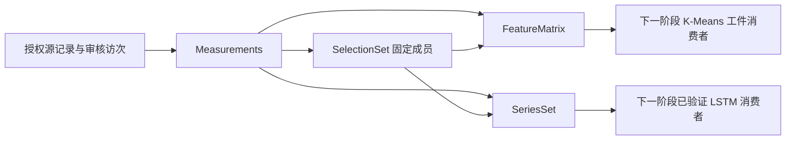

# 第二阶段交付与剩余任务

本文件保留第二阶段交付记录；科学 DAG、扫描/聚类工件和固定成员历史已在第三阶段实现，当前剩余工作以 [第三阶段交付与剩余任务](第三阶段交付与剩余任务.md) 为准。

2026 年 10 月 14 日已完成统一测量与科学工件基础。病媒数据现在可以经过服务端技能生成 Measurements、SelectionSet、FeatureMatrix 和 SeriesSet，并以 ArtifactRef 在步骤间传递。采样访次与投入采用独立审核登记，稳定地点键来源于数据集和原始地点主键；旧记录没有被推断或改写成标准密度。

本阶段支持数据准备和契约串接。完整 SaTScan、独立 K-Means 工件消费者、LSTM 权重与持久科学 DAG 仍按下一阶段实施，不能将本阶段工程完成等同完整科学流水线验收。

## 已交付能力

| 服务端技能 | 输入与最终行为 |
|---|---|
| `skill_sampling_event_register` | 根据授权源记录 ID、原始访次号、明确投入值/单位和证据，审核登记同一访次；同一地点、方法、日期的记录仍须人工明确访次，不能自动按日期合并。 |
| `skill_measurement_prepare` | 按批准的时间、辖区、物种及方法读取监测源，分页产生 Measurements 工件；记录总数、完整性、原始投入、已审核访次与稳定地点键。 |
| `skill_selection_build` | 从完整 Measurements 中选择实际地点成员；允许显式空集，但拒绝不存在、重复或来自其他源工件的成员。 |
| `skill_feature_matrix_build` | 按固定地点聚合特征，保留列名、单位和行键；可选择测量值、记录数、访次数，缺失值不编造；拒绝混合采样方法的地点特征。 |
| `skill_series_build` | 按固定地点、方法、物种生成日、周或月等间隔序列；真实零保留，未采样/投入未知返回 null；首尾不完整周/月另行标记。 |
| `skill_scientific_artifact_read` | 校验工件引用和当前授权，支持期望类型、单位、特征列单位、测量定义、频率、有限值和完整日历期门禁；仅向模型/界面返回有限预览。 |

这六项已纳入统一服务端目录。公开技能 ID 从 58 个增加至 **64 个**，内部技能仍为 1 个；四域共 100 个展示位置，其中病媒 37、食源 20、环境 21、慢病 22。新增能力标记为“部分实现”和“工程契约已验证”，专业密度和模型效果仍需验收。

## 访次与分母规则

统一测量记录包含 `recordId`、`sourceLocationId`、`locationKey`、`date`、`methodId`、`speciesId`、捕获数、原始 `legacySamplingUnit`、已审核 `visitId`、`effortValue` 和 `effortUnit`。

1. 地点键为 `location:<编码后的datasetId>:<编码后的sourceLocationId>`。不同数据集、不同原始地点主键不会因地名、街道或坐标相同而合并。来源必须持续维护地点主键的身份；跨来源地点匹配或来源复用旧主键需要另行审核。
2. 旧 `sampling_unit` 仅保留为原始字段，未登记明确访次与单位的记录，其 visitId/effortValue/effortUnit 为 null。不得将同日同点记录自动算作一次采样。
3. 审核登记只接受服务端授权范围内的实际记录，同一访次必须具有一致地点、方法和采样日期。原始访次号在数据集版本和组织内幂等；不一致重放或将同一记录归入两个访次会失败，并回滚整个事务。
4. 一次访次的多个物种记录共享同一投入。聚合多个物种时，投入按 visitId 去重一次；不同访次即使发生在同一天也分别累计。物种序列中，投入只在该序列涉及的访次内计算，未记录某物种不能据此推断为零捕获。
5. 支持明确的台时、台夜、人时、房间数和台次编码：`trap-hour`、`trap-night`、`person-hour`、`room`、`trap-visit`。不自动换算台夜与台时；归一化请求必须指定投入单位，不匹配即拒绝。普通捕获统计遇到不同投入单位时，不合计投入数值。
6. 提供 `capture-count`、`capture-per-record`、`capture-per-effort` 三种测量定义。审核登记后的投入比值具有明确分母，尚不代表特定监测规范中的密度定义已获专业签收；方法适用单位、采样设计与专业政策仍需业务验收。
7. 源记录哈希与审核登记绑定；已审核记录的捕获数、日期或其他关联字段被修改后，再准备测量工件会拒绝继续使用旧登记。

例如，某地点一次访次记录两种蚊类，捕获 5 与 15 只、投入 2 台时；同日另一次访次捕获 10 只、投入 3 台时；后续一次真实零捕获访次投入 1 台时。聚合结果是 30 / (2 + 3 + 1) = 5 只/台时，分母不能因为第一访次有两个物种记录而重复计为 8 台时。该例已纳入回归测试。

## 工件契约与权限

| 契约 | 核心内容 | 校验 |
|---|---|---|
| ArtifactRef | 工件 ID、类型、schemaVersion、领域、内容哈希、批准范围指纹、DatasetRef | 必须与服务端保存引用完全一致；修改类型、哈希、领域或来源不能取得内容。 |
| Measurements | 统一监测记录、匹配记录总数、是否完整 | 记录身份唯一，日期在窗口内，捕获与投入值有限，已审核访次的地点/方法/日期/投入一致。 |
| SelectionSet | 排序后的稳定地点成员键 | 成员来自指定 Measurements；源工件完整，禁止跨源混用和重复/伪造成员。 |
| FeatureMatrix | 地点行键、列名/单位、数值矩阵 | 行列维度一致、行键及列名唯一、有限数或显式 null；消费者可声明所需列及单位。负的标准化特征在契约上允许，当前生成器输出测量与计数特征。 |
| SeriesSet | 地点/方法/物种对象键、完整日历轴、每期值及采样分母 | 日/周/月明确，周以星期一为起点，月以第一日为起点；日历连续，缺测显式为 null，首尾部分周期有标记。 |

工件包还包括生成 runId/callId/skillId、生成及失效时间、数据窗口、asOf、测量定义、单位、频率、对象键、质量标记和上游依赖。内容使用稳定 JSON 计算 SHA-256；原始批准范围按既有冻结协议保存，恢复时重新校验，避免 JSON 键排序改变既有范围指纹。

读取时重新验证用户、组织、领域、角色、当前辖区、批准范围、来源版本和数据用途策略；公众不能读取科学工件，采样投入审核还要求服务端专业复核权限。引用只提供身份，不能绕过授权。跨用户共享和权限委托尚未提供。

当前要求同一科学任务的根批准范围指纹一致。成员可以在根范围内缩小；底层保存函数允许时间窗口在根范围及全部父工件窗口内缩小，禁止扩大。请求范围变化、数据版本变化或角色变化需要重新准备工件。后续 DAG 的节点子窗口将由服务器编译，不能由模型自行扩大历史读取权限。

工件有效期为 24 小时，派生工件不得晚于任何上游工件失效时间；过期会拒绝读取。模型消费可要求有限值，含 null 的矩阵/序列不通过该门禁；也可拒绝首尾不完整周期。过期留档清理、长任务保留策略和审批后跨人员共享另行实施。

## 数据读取及现有算法变化

科学准备使用独立的固定投影和主键游标分页，单页最多 1,000 行，默认总预算 10,000 行、最大 50,000 行。它不接受自由 SQL，重新编译服务端批准的地域、时间和筛选条件，并继续通过事实库只读连接、域内字段和来源策略校验。截断来源会被标记，SelectionSet 和后续计算拒绝消费它。

普通 Text2SQL 的语法、行数及筛选门禁保持生效；没有增加客户端可传入的“绕过范围检查”参数。1,006 条隔离源记录的分页测试验证了不会沿用交互查询 200 行上限而丢失训练来源。

现有 Python 物种 K-Means 汇总加入 location_id/species_id/method_id 分组和成员输出；同坐标不同点位保留独立成员，samplePointCount 按真实地点计数。地图成员采用地点/物种/方法组合身份。既有 AR、GBDT、IDW 和近似扫描的统计含义仍按其原方法声明，没有自动切换为新的投入比值。

## 流水线的下一步连接方式

后续扫描应消费规范化的观测及投入，产生真实簇成员，服务器将成员地点 ID 转为 SelectionSet。特征和历史序列消费同一 Measurements 与 SelectionSet，不回退成整城市筛选，不经由 LLM 复制矩阵。

扫描窗口、训练历史和预测跨度分别声明。SaTScan 子窗口与固定成员历史读取要由 DAG 在根批准范围内编译；当前旧扫描仍从原事实库执行，尚未接入工件输入。K-Means 的模型状态和分组工件、LSTM 的权重及推断接口也未恢复，本阶段没有产出深度预测。

## 当前快照验证

使用当前登记为 observed 的病媒快照，按郑州市、2024 年、蚊类、诱蚊灯法执行实际 Skill 链：

| 步骤 | 结果 |
|---|---|
| Measurements | SUCCESS，269 条实际授权记录 |
| SelectionSet | SUCCESS，27 个稳定地点 |
| FeatureMatrix | SUCCESS，27 行，捕获量/记录及记录数特征；不使用含义未确认的旧投入 |
| SeriesSet | INSUFFICIENT_DATA，52 个地点/方法/物种序列；缺测保持 null，未伪造完整预测输入 |

见 [当前快照运行证据](phase-two-evidence/observed-foundation.json)。该验证使用隔离临时业务库，测试后清理工件存储；保留的证据用于核对实际结果，不是可继续调用的生产工件引用。

## 部署和使用

新增 [010_scientific_artifacts.sql](../../../migrations/sqlite/010_scientific_artifacts.sql)，包含采样访次、记录归属和科学工件三类表。部署前备份业务库，通过既有 `node scripts/migrate.cjs` 或部署入口应用新迁移，沿用目标 `APP_BUSINESS_DB_PATH`；旧迁移校验和不变，事实数据库保持只读。

使用顺序为：准备授权记录或查询原始记录 ID → 专业人员依据采样单审核登记访次/投入 → 重新准备 Measurements → 创建 SelectionSet → 生成矩阵或序列 → 用期望单位、频率和有限值要求验证工件。旧数据不需要批量自动补造访次；未经核对的记录可继续进行明确的捕获/记录统计。

## 更新后的剩余任务

| 优先级 | 剩余工作 | 依赖与验收 |
|---|---|---|
| P1 | 专业分母与原始访次资料接入 | 原始采样单、访次号、方法规范和投入单位；逐批审核，建立方法适用单位及质量政策。当前只能登记已有源事实记录，移动采集与事实入库流程仍须接入规范化层。 |
| P1 | 科学 DAG 编译与持久执行 | 复用已交付工件；根授权范围和节点子窗口、依赖/分支、节点状态、有限重试、取消、恢复及幂等。 |
| P1 | 扫描工件输入与簇成员输出 | 正式/明确近似扫描、规范暴露、成员 ID 和零热点分支；对照官方实现的独立科学验证。 |
| P1 | K-Means 原子技能与分组契约 | 消费 FeatureMatrix，训练预处理、列与单位校验、K 选择、模型状态及稳定成员；聚类不自动成为风险等级。 |
| P1 | LSTM 模型注册与工件推断 | SeriesSet 门禁、频率及时间截止、权重/scaler/特征版本、滚动回测和外部留出；缺测处理要有验证，不能默认补零。 |
| P1 | 原子与端到端科学验收 | 扫描→成员→特征→聚类→固定成员历史→预测；全部使用同一来源/对象与已批准历史，验证数据泄漏和模型效果。 |
| P1 | 真数据质量及实时接入 | 三域真实数据、病媒投入与更新延迟；数据就绪状态、来源内容版本及导入校验。 |
| P2 | 工件生命周期及共享 | 长任务保留、清理归档、机构内委托、审批后共享与撤权；当前严格同用户同角色读取。 |
| P2 | 其他领域统一测量 | 食源病例/暴露、环境采样、慢病人群/人年各自的规范化适配，不能套用病媒投入编码。 |
| P2 | 专业预警 空间验证 报告与移动能力 | 延续 [第一阶段剩余清单](第一阶段交付与剩余任务.md) 中尚未完成的业务模型、政策、街道/插值验证、外部推送、报告模板和 OCR/离线事项。 |

原 18 个 planned 技能没有因工件基础完成而改标为完成。第二阶段完成了数据准备与引用基础，不能替代完整专业模型及科学流水线验收。

## 验证记录

最终记录见 [验证汇总](phase-two-evidence/summary.json)：前端/服务 493 项通过、1 项真实 LLM 测试未启用而跳过；科学 37 项、集成 51 项、隔离兼容 44 项通过。TypeScript、lint 和生产构建通过；兼容回归前后源文件哈希未变化，四域监测快照与第一阶段证据一致；业务库属于运行状态，不以跨阶段业务库哈希相同作为承诺。

新增 13 项工件与访次测试覆盖分母去重、同日独立访次、地点身份、单位/频率/列形状、零值/缺测、分页、截断、来源修改、过期、哈希篡改、用户/组织/角色/当前辖区和批准范围。另新增同坐标不同地点的 Python K-Means 成员测试。真实快照 Skill 链保留数据不足结果，没有将序列缺口声称为模型成功。

证据：[前端及服务](phase-two-evidence/refactor.log)、[科学测试](phase-two-evidence/scientific.log)、[集成测试](phase-two-evidence/integration.log)、[生产构建](phase-two-evidence/build.log)、[兼容回归](phase-two-evidence/baseline.log)、[源数据保护](phase-two-evidence/source-protection.json)、[当前能力目录](phase-two-evidence/catalog.json)。本轮没有训练 LSTM、运行完整科学 DAG 或进行浏览器手工验收。
