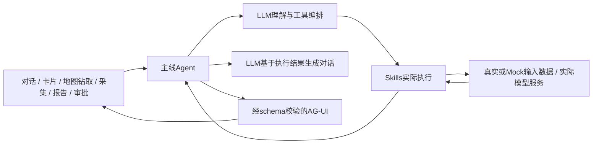

# CdcBuddy 分阶段重构实施计划（修订版）

> **实施说明：**用户已批准开始重构；隔离分支按12任务连续实施，已完成T1—T8。执行使用 `superpowers:executing-plans` 按任务逐项实施，步骤采用复选框记录；如用户另行选择子代理执行，再切换相应流程。

**目标：**保留现有四领域交互资产，建立统一、可维护、可追溯的业务内核；以病媒真实数据验证实用效果，以其他三域Mock数据验证实际功能与算法执行链；所有功能交互均经主线Agent的LLM+Skills返回对话与AG-UI，随后建设RBAC和试点运行能力。

**架构：**采用模块化单体，保留Next.js/React与Python；先统一结果契约、领域数据访问、技能执行和聊天服务，再实现持久计算任务与业务闭环。短查询继续同步，重计算逐步交给Worker；领域模块保持独立边界，暂不拆成四套微服务。

**技术栈：**现有Next.js、React、TypeScript、better-sqlite3、Python、NumPy/Pandas、LangGraph；沿用专业图表/GIS组件。测试拟补Vitest与ESLint，正式依赖版本在执行时选定并锁入package-lock；不在本轮安装。

**依据：**[成果评估报告](../../reviews/2026-10-12/项目成果与架构评估报告.md)、[原改进方案](../../reviews/2026-10-12/架构重构与分阶段改进方案.md)、[No.23—76原始需求清单](../../../plan/人工智能-四智能体-功能清单.md)及用户2026-10-12的补充。

**版本：**v3（补充所有功能真实执行、主线Agent统一交互约束）；取代原改进方案的实施顺序与估算。原报告的问题证据继续保留，数据来源及RBAC状态按本计划修订。

## 一、已确认的现状与评估修正

| 项目 | 已确认事实 | 对计划的影响 |
|---|---|---|
| 病媒数据 | 真实监测数据 | 保护原库；真实数据支持统计与回测，但不自动证明训练模型或业务效果达标 |
| 食源数据库 | Mock | 保留为功能测试底座；不将数据库Mock视为缺陷，不要求先购买/接入真实数据 |
| 环境数据库 | Mock | 同上；合成输入应该驱动真实算法与状态流转 |
| 慢病伤害数据库 | Mock | 同上；Mock精度/指标不能当真实医学效果 |
| RBAC | 尚未实现；已有前端角色示例不等于服务端RBAC | 列为独立新增能力，改变原报告“已实现但不安全”的表述；多人真实数据试点前必须完成 |
| 固定输出/未训练模型 | 评估已定位，与数据来源是两回事 | 继续纠正：如固定Pearson、DLNM、准确率、识别结果、送达/复测值；Mock数据库也不应替代真实计算 |

**三个必须分开的维度：**数据来源（真实/Mock）、实现方式（实际查询计算/数据驱动规则/尚未实现的固定演示）、验证层级（工程回归/真实数据回测/业务验收）。例如“从Mock污水序列计算Pearson”是有效工程实现；“读取任意数据库都返回0.912”仍是固定演示。

原评估29项部分实现、21项演示为主、4项缺核心实现的分类反映实现链路，并非对数据库Mock的惩罚；本次不把三域全部改为“已完成”。待相应任务执行后，按新证据重评。

## 二、全局约束

- 用户已于2026-10-12授权开始重构；按任务逐项实施和验证，不修改真实源库。
- `vector_monitoring.db`作为真实源库只读使用；测试/回测使用快照，不在原库增删数据。
- 其他三域Mock库继续保留；合成数据生成固定seed与版本，测试使用临时库。
- 不将 `NODE_ENV=production` 等同于真实业务模式；生产构建也可运行显式Mock演示。业务部署等级另用 `DEPLOYMENT_TIER=local|demo|pilot`。
- 数据来源按**领域/数据集**标识，不用平台全局开关把病媒真实数据和其他三域Mock一并禁止。
- 未评估的模型效果指标不能填虚构值；相关性、p值和统计量必须来自实际计算。准确率、送达状态、复测结论不可硬编码；NO_DATA与FAILED不得伪装SUCCESS。
- 保留旧API路径、技能ID/别名、现有卡片与历史会话读取适配；逐项迁移，不一次性搬目录。
- RBAC完成前只允许受控本地研发/演示；此限制不是新增“登录”弹窗代替授权，也不声称已有安全隔离。
- RBAC、数据库驱动、OCR/图像模型和全功能补齐分别算新增开发，不纳入“纯重构已完成”的口径。
- PostgreSQL/Kingbase、真实三域数据接入、完整专业模型训练另立后续项目；当前先统一边界，不提前重写数据库驱动。

### 2.1 不可变更的交互与实现要求（用户2026-10-12补充）

**唯一功能交互主线：**用户输入或操作 → 主线Agent → LLM理解/编排 → Skills实际执行 → 主线Agent基于产物生成对话 → AG-UI呈现与下一步操作。对话和AG-UI来自同一run与同一产物，不能分别维护两个数据来源。



- **Mock只限定数据来源。**数据库中的病例、采样、时间序列可为合成数据；算法、查询、模型推断、CRUD、审批、复测、报告导出必须实际执行并留下证据。
- **不得通过固定响应替代实现。**包括不消费图片的识别、预设OCR字段、固定风险/统计量/准确率、随机未训练权重充当模型、固定溯源、虚构通知送达和核销、仅返回“已触发”文字而无产物。
- **确定性的有效计算不是固定答案。**依据输入执行SQL、数学公式、经过定义和校验的业务规则可以保留；常量可以用于版本化标准参数/阈值，不能当作已计算结果。改变相关数据时输出应按算法预期变化；不相关数据不要求改变输出。
- **功能按钮也是Agent交互。**点击技能、地图下钻查询、采集识别/校验/提交、报告生成/导出、技能创建/编辑/删除、会话操作和业务审批，统一转成AgentInteraction；不能在组件里直接返回固定分析卡片或绕过Agent执行功能。
- **协议和界面基础动作不伪装成Agent能力。**SSE传输、身份会话校验、文件字节下载、视觉平移/缩放、主题切换等仅承载/显示已授权产物，不独立生成对话或分析结果；地图一旦涉及新数据查询，必须回主线Agent。
- **LLM不能被规则兜底替代。**LLM不可用时可重试/切换另一个LLM；仍失败就显示服务错误与AG-UI错误状态，不继续靠关键词Switch生成成功业务结果。完成查询/业务操作的成功turn必须有真实LLM编排和真实Skills调用。
- **自然对话不能虚构工具证据。**澄清可返回追问与AG-UI参数收集；知识问答通过检索Skill，不能仅依赖固定解读模板；没有执行结果不声称完成。AG-UI从可验证Skill数据装配，不让LLM任意生成可执行代码。
- **测试替身仅限测试环境。**单元/契约可用LLM/provider stub测试超时和分片，但功能验收必须运行真实LLM、实际Skill和数据库/文件/状态验证。
- **写操作保持原始用户意图。**审批决定、资源ID、角色/辖区、复测证据不能被LLM任意修改；通过Skills的schema、授权、幂等和状态机校验后才执行。后台调度触发主线Agent任务，经过LLM+Skills进行策略/工具编排，实际数据读取与副作用经过Skills；LLM不可用不得旁路生成成功告警。数据监听和定时器仅负责发起任务，不在旁路脚本产出固定告警。

这些是架构验收条件；“标成demo”“改名字”“暂时返回固定结果”均不能满足。阶段内未实现能力可明确不可用，但最终功能交付仍须实际实现并沿此主线验收。

## 三、审阅重点与对应验收

1. 真实病媒和Mock三域在同一部署中使用：每次结果准确标记来源，域配置不靠公网端口猜测（T1/T3/T6）。
2. 用户输入不存在城市、零阳性、零捕获、未知死因：保留0值，返回无数据/需复核，不给默认诊断或扩大辖区（T2/T8/T9）。
3. LLM超时、多工具调用与SSE分片：允许受控重试或切换可用LLM；无可用LLM时明确失败，不绕开Agent返回业务结果；流式/非流式一致，错误不继承旧成功视图（T5/T6）。
4. 用户重复点击、Worker重启、审批未通过、复测不合格：不重复派单/通知，不跳过审批，不提前核销（T7/T10）。
5. 公众或基层请求其他人的会话/私有技能/辖区数据：服务端拒绝；前端角色切换不能授予权限（T11）。

## 四、目标结构和关键接口

### 4.1 目录与责任

```text
src/
  app/api/                         # 旧路由保留为协议适配
  contracts/                      # 结果、数据集、技能、事件、运行上下文
  application/
    dispatch/ skills/ sessions/ jobs/ alerts/ tickets/
  domains/
    vector/ foodborne/ env/ chronic/ # 领域技能与业务规则
  infrastructure/
    db/ analytics/ llm/ query/ auth/ events/
  features/workbench/             # Web与浮窗共用状态控制器
  components/ag-ui/               # 继续复用现有卡片
analytics_engine/
  contracts/ repositories/ graphs/ jobs/
  *.py + foodborne/ env/ chronic/  # 先保留旧算法位置，逐个迁移
migrations/sqlite/
tests/refactor/                   # TS契约/服务/流程测试
tests/scientific/                 # Python数学基准/时间回测
tests/integration/                # 临时DB与任务恢复
```

### 4.2 拟议接口契约

下列为实施约束，执行时不得各任务分别重命名或重复发明协议：

| 类型/接口 | 定义与调用要求 |
|---|---|
| `AgentDomain` | `'vector' | 'foodborne' | 'env' | 'chronic'` |
| `DataOrigin` | `'observed' | 'mock'`；单个结果涉及多个数据集时由`datasets[]`逐项标识，不丢掉Mock来源 |
| `DatasetRef` | `{id, domain, origin, version, asOf, schemaVersion}`；文件路径不发到客户端 |
| `ExecutionContext` | `{runId, domain, deploymentTier, principal, signal?}`；principal由服务端提供，见T11；研发时显式dev principal |
| `SkillResult<T>` | `{schemaVersion:'1', runId, domain, status, method, datasets:DatasetRef[], payload:T|null, metrics, qualityFlags, error?}`；status为`SUCCESS|NO_DATA|INSUFFICIENT_DATA|FAILED|REVIEW_REQUIRED|CANCELLED` |
| `MetricEvidence` | `{value:number|null, evaluationKind:'unvalidated'|'computed'|'synthetic'|'real-backtest', datasetIds:string[], definition:string}`；`unvalidated`时value必须null；统计量实际计算标computed，不能据此宣称模型泛化达标 |
| `SkillDefinition` | `{id, aliases, domain, requirementIds:number[], inputSchema, outputSchema, method, allowedOperations, execute(args,ctx)}`；input/output用可验证JSON Schema |
| `executeSkill(id,args,ctx)` | `Promise<SkillResult<unknown>>`；旧`executeSkillServer`只做代理，仅由主线Agent的已校验tool call进入；旧业务直调入口迁移为Agent交互适配器 |
| `getDomainRepository(domain)` | 返回只读事实Repository；查询方法统一`query(select, params, scope)`，scope含domain/城市/区县/时间窗 |
| `dispatch(request,ctx)` | `AsyncIterable<RunEvent>`；`collectDispatch(events)`生成非流式结果；HTTP/SSE共享主线Agent实际执行；每次功能交互由LLM编排、Skills执行并返回reply+AG-UI |
| `AgentInteraction` | `{interactionId,kind,userInput,resourceRef?,attachments?,viewContext?}`；kind覆盖对话、卡片操作、地图钻取、采集、报告、会话管理和审批；不接受客户端角色授权 |
| `AgentTurnResult` | `{runId,replyText,agui,skillRuns,status}`；业务成功必须同时有可追溯Skills产物、LLM答复和AG-UI payload |
| `RunEvent` | `{version:1,runId,seq,type,data}`；type至少包含started/tool_started/tool_completed/result/failed/completed |
| `runAnalytics(request, options)` | 接收`{task,args,domain,datasetId}`和`{timeoutMs,signal?}`，返回校验后的`SkillResult` |
| `submitJob(command,ctx)` | 返回`{jobId,status}`；持久任务明确`QUEUED|RUNNING|WAITING_REVIEW|SUCCEEDED|FAILED|CANCELLED` |
| `resolvePrincipal(request)` | `Promise<Principal|null>`；`authorize(principal, operation, resource)`在服务端校验 |

采用现有Python Pydantic校验算法输出；TS JSON Schema校验器在T2按已有依赖可用性选定并锁版。保留旧卡片payload形状，通过适配器逐个套入新结果封套。`success`旧字段只作兼容映射，不能覆盖真实status。

## 五、阶段和里程碑

| 里程碑 | 任务 | 交付目标 | 退出标准 | 估算 |
|---|---|---|---|---:|
| M0 基线 | T1 | 数据来源、测试底座、需求映射 | 原库保护、三域Mock可复现，来源有明确标记 | 2—3人日 |
| M1 共用内核 | T2—T7 | 可信输出、领域数据边界、主线Agent统一交互、共享交互、有界执行 | 所有功能入口无旁路；四域/双入口契约测试通过 | 32—50人日 |
| M2 计算与流程 | T8—T10 | 病媒真实分析基线、三域Mock数据驱动计算、持久任务与病媒闭环 | 实际结果随输入变化，任务/审批/复测可验证，工程与真实效果分开 | 22—34人日 |
| M3 新增权限与试点准备 | T11—T12 | RBAC、CI、部署分级、真实LLM端到端验收 | 服务端授权、恢复、真实LLM+Skills+AG-UI检查通过后才允许试点 | 12—20人日 |

**主线合计68—107工程人日**，属于初步预算，不等于完成54项所有需求或所有科学模型。M0—M1先行约34—53人日；后续可根据阶段成果调整预算。原v2预算60—93人日；v3增加全入口Agent统一和真实LLM验收的8—14人日。估算含本计划限定的修复和新增工程，不含三域真实数据接入、标注、完整模型研发、OCR/图像识别、Kingbase适配和外部通知渠道协调。

依赖：T1→T2/T3→T4→T5→T6；T3/T4→T7；T7→T8/T9；T7/T8→T10；T2/T3/T4/T6/T10→T11；T11与阶段验收→T12。RBAC的权限矩阵设计可在M1阶段提前完成，实施以稳定的服务/Repository为基础；期间不开放真实数据多用户访问。

## 六、可执行任务清单

### Task 1：建立数据与测试基线

**文件：**新增 `config/datasets.json`、`src/infrastructure/db/dataset-manifest.ts`、`tests/fixtures/dataset-manifests.json`、`tests/refactor/datasets.test.ts`、`tests/integration/test_fixture_isolation.py`；修改 `package.json`、Mock生成脚本；新增 `eslint.config.mjs`、测试配置。

**接口：**`loadDatasetManifest(): DatasetRef[]`；manifest将vector标observed，foodborne/env/chronic标mock。增加`test:refactor`（Vitest）和 `tests/run_scientific.py`、`tests/run_integration.py`；两个Python runner把传入选择名解析为`tests/scientific/test_<选择名>.py`或对应集成套件，零用例/未知选择名必须非零退出；`test:scientific`支持`test_vector_methods`等文件基名选择，`test:integration`支持jobs/auth/deployment选择。lint改为非交互ESLint。

- [x] 写反例：来源字段缺失时拒绝加载；四域映射分别是observed/mock/mock/mock；测试写临时目录而非源库；同seed生成的关键事实与业务指标一致。
- [x] 运行 `npm run test:refactor -- datasets` 和 `.venv/bin/python -m unittest discover -s tests/integration -p 'test_fixture_isolation.py'`，确认新增约束测试先失败。
- [x] 实现manifest、seed参数、独立测试配置和临时DB路径；不重建当前数据库，不批量改变历史seed数据。
- [x] 运行以上命令及`npm run lint`、`tsc --noEmit --incremental false`，要求退出0；保留关键病媒聚合快照及旧44项回归证据。
- [x] 提交本任务代码与文档，commit建议：`test: establish dataset provenance and isolated fixtures`。

### Task 2：结果契约与已复现错误纠正

**文件：**新增 `src/contracts/skill-result.ts`、`src/contracts/dataset.ts`、`src/contracts/execution-context.ts`、`src/contracts/principal.ts`、`analytics_engine/contracts/result.py`、`tests/refactor/results.test.ts`、`tests/scientific/test_result_semantics.py`；修改水质、传播风险、死因编码、cgMLST、移动API及报告中的对应分支。

**接口：**产出第四节的`SkillResult<T>`/`DatasetRef`/`MetricEvidence`/`ExecutionContext`/`Principal`与`validateSkillResult(value)`；后续T4/T7必须使用。

- [x] 写失败断言：水质达标率为`337条样本中的达标数/337*100`且≤100；max=max原始值；不存在市返回NO_DATA/payload=null；零阳性为0；未知死因REVIEW_REQUIRED；空基因向量拒绝比较；捕获0保留0。
- [x] 运行 `npm run test:refactor -- results` 与 `npm run test:scientific -- test_result_semantics`，确认原实现无法满足断言。
- [x] 实现封套和验证；旧报告/解释删除固定达标声明，错误与无数据展示明确状态；未评估指标value=null。修复原评估探针对应根因。
- [x] 重跑以上测试，要求全部通过；验证旧卡片适配保留已有效字段，空结果不展示默认成功指标。
- [x] 提交：`fix: distinguish execution status and correct result semantics`。

### Task 3：统一领域数据访问与运行配置

**文件：**新增 `src/infrastructure/db/domain-repository.ts`、`src/infrastructure/query/query-gateway.ts`、`src/application/config/runtime-profile.ts`、`src/app/api/runtime-profile/route.ts`、`analytics_engine/repositories/datasets.py`；修改SQLite provider、agent-profile、engine及三域算法DB路径；新增 `tests/refactor/domain-repository.test.ts`、`tests/refactor/query-gateway.test.ts`、`tests/refactor/runtime-profile.test.ts`及 `tests/integration/test_domain_paths.py`。

**接口：**`getDomainRepository(domain)`、`getRuntimeProfile(domain): {domain,datasets,capabilities}`、`executeReadQuery(query,scope)`。scope显式包含domain与地理/时间条件；T11把服务端授权范围注入scope。

- [x] 测试：环境查询不能读病媒表；不存在city不退回全省；显式`LIMIT 1000000`被拒；多语句/不允许表列被拒；换DB路径后结果读取新库；公网自定义端口不改变domain。
- [x] 运行 `npm run test:refactor -- domain-repository query-gateway runtime-profile`，确认缺失边界先失败。
- [x] 实现路径配置、领域Repository与单语句AST/表列/数量控制；删除本机绝对路径fallback；业务运行配置由服务端注入，Mock域可显式运行demo。
- [x] 运行上述契约测试和Python临时DB集成；查询白名单只列现有需求实际用到的SQL构造，不承诺任意SQL兼容。
- [x] 提交：`refactor: unify domain datasets and controlled query execution`。

### Task 4：技能注册与执行按领域拆分

**文件：**新增 `src/application/skills/skill-service.ts`、`src/domains/{vector,foodborne,env,chronic}/skills/index.ts`、`src/contracts/skill-definition.ts`；修改 `registry.ts`、`server-executor.ts`、`api/skills/route.ts`；新增 `tests/refactor/skill-service.test.ts`。

**接口：**`listSkillDefinitions(domain)`、`executeSkill(id,args,ctx)`。统一保存`requirementIds`，旧字符串编号由适配器生成；别名解析只指向一个标准ID。

- [x] 测试：旧ID和别名结果一致；未知ID拒绝；输入schema失败不启动计算；输出schema失败标FAILED；三域自定义技能按存储domain查询；SQL异常不伪造“执行完成”。
- [x] 运行 `npm run test:refactor -- skill-service`，确认新的统一入口约束先失败。
- [x] 每次迁移一组技能到领域模块；旧executor变成代理；保留UI类型；纠正No.56/58及慢病编号映射。
- [x] 运行上述测试和旧回归；覆盖所有已注册ID的输入/输出fixture，禁止遗漏通过default分支吞掉错误。
- [x] 提交：`refactor: organize skills by domain behind one execution service`。

### Task 5：主线Agent统一编排与流式/非流式调度

**文件：**新增 `src/application/agent/main-agent.ts`、`src/contracts/agent-interaction.ts`、`src/application/dispatch/dispatch-service.ts`、`src/infrastructure/llm/client.ts`、`src/contracts/run-event.ts`、`src/application/dispatch/legacy-adapter.ts`；修改dispatch和stream-dispatch路由、llm-router；新增 `tests/refactor/dispatch.test.ts`。

**接口：**`dispatch(request,ctx): AsyncIterable<RunEvent>`、`collectDispatch(events)`；实现 `runAgentTurn(interaction,ctx): AsyncIterable<RunEvent>`，由LLM生成工具调用→T4的executeSkill→LLM基于产物生成答复→由Skill产物/组件schema构造AG-UI。tool循环上限拟定4轮/8次执行，默认保留现有LLM超时配置；达到上限明确失败/结束，不递归无限调用。

- [x] 测试：同一受控LLM响应下，流式/非流式skillId、status、payload一致；LLM超时仅重试/切换模型，无可用LLM则FAILED且Skills调用次数为0，不走规则兜底；两个tool按顺序执行；超预算终止；服务端domain不受客户端伪造改变。
- [x] 运行 `npm run test:refactor -- dispatch`，使用确定性LLM stub而非外网调用，确认失败。
- [x] 抽取重复统计/提示词/解释，两个API只做主线Agent协议适配；移除生产路径的fallbackRuleMatch直接执行、固定解释答复和Copilot仅返回成功文字的占位action。统一错误事件与取消信号，保留旧客户端事件转换。
- [x] 重跑测试；增加JSON/tool/SSE分片边界fixture；所有成功业务turn同时断言LLM调用、Skills实际产物、replyText与AG-UI。没有实际执行的占位action不得通过；失败不标success/旧viewReady。
- [x] 提交：`refactor: share dispatch execution across HTTP and SSE`。

### Task 6：共享工作台、会话与旧视图兼容

**文件：**新增 `src/application/agent/interaction-adapter.ts`、`src/domains/common/interaction-skills.ts`、`src/features/workbench/use-workbench-controller.ts`、`src/features/workbench/session-client.ts`、`src/features/workbench/result-adapter.ts`；修改page、EmbeddedWidget、SessionHistoryDrawer、Renderer；新增 `tests/refactor/workbench.test.tsx`。

**接口：**`useWorkbenchController({domain,client})`暴露send/cancel/loadSession/startSession与工作台状态；同一service为Web和Widget提供能力；新增 `interact(interaction: AgentInteraction)`，send/loadSession/startSession及功能按钮统一转换交互事件调用T5主线Agent。

- [x] 测试：两个入口同输入得到相同状态转移；技能卡/地图钻取/移动采集/报告生成导出/会话管理/审批按钮全部有同一Agent runId，不能直接调用业务执行API；未知城市清空当前分析结果而不保存旧成功快照；读取旧会话fixture正常；新结果显示各domain真实/Mock来源；快速取消和切会话不串消息。
- [x] 运行 `npm run test:refactor -- workbench`，验证新增状态/兼容断言失败。
- [x] 将所有功能交互、SSE订阅、会话读写与视图恢复移入共享controller；扩展对应session/report/collection/review等Skills。旧REST业务入口做代理或限制为内部，不能绕过Agent执行功能；来源标签按结果datasets决定。
- [x] 运行测试并浏览器验证四领域Web/Widget；逐入口检查主线Agent→LLM→Skills→reply+AG-UI追踪，及source标签、NO_DATA和旧快照；纯展示动作不触发新业务计算。
- [x] 提交：`refactor: share workbench and session state between entry points`。

### Task 7：有界算法Runner与LangGraph入口整理

**文件：**新增 `src/infrastructure/analytics/runner.ts`、`analytics_engine/contracts/task.py`、`analytics_engine/graphs/registry.py`；修改engine-bridge、engine、langgraph_app和实际执行图；新增 `tests/refactor/analytics-runner.test.ts`、`tests/integration/test_graph_contract.py`。

**接口：**`runAnalytics(request,options): Promise<SkillResult<unknown>>`；保留CLI兼容，图registry统一解析，去掉未被真实执行入口使用的重复中枢。

- [x] 测试：非法task拒绝；超时/取消终止子进程并释放槽位；非有限JSON/异常输出标FAILED；峰值运行并发不超过2；指定datasetId被传给Python；图结果符合T2契约。
- [x] 运行 `npm run test:refactor -- analytics-runner` 与 `.venv/bin/python -m unittest discover -s tests/integration -p 'test_graph_contract.py'`，确认旧Runner不满足限制。
- [x] 实现默认并发2、子进程超时120秒、stdout上限8MiB/stderr上限1MiB；全部可配置，超限失败；删除静默正则修补NaN；stdout只用标准协议。
- [x] 重跑测试及一个真实病媒计算快照；能力变化时才调整预算，不从有限数据推断生产容量。
- [x] 提交：`refactor: bound analytics execution and consolidate graph entry points`。

### Task 8：病媒真实数据分析基线与可复现回测

**文件：**修改population_dynamics、density_gbdt、lstm_predictor、satscan_cluster、transmission_risk、resistance相关模块；新增 `tests/scientific/test_vector_methods.py`、`analytics_engine/vector_backtest.py`和回测结果manifest。

**接口：**预测增加显式`as_of`/`data_window`；`evaluate_vector_forecast(dataset_id, as_of, horizon)`返回MetricEvidence。方法名称按实际实现声明；无训练模型时不发布LSTM能力为validated。

- [x] 测试：读取asOf前最近窗口而非最早60条；添加asOf后记录不改变当次预测；R²允许真实负值，不做下限截断；零病原不被替换1；不同采样方法/单位不混合；固定seed扫描可复现。
- [x] 运行 `npm run test:scientific -- test_vector_methods`，确认原时间/指标逻辑不满足。
- [x] 先保留并校正真实AR/GBDT/IDW/K-Means/Apriori等子能力，建立季节基线和滚动回测；捕获量不足以代表标准密度时明确单位/分母不足；KDR用药/基因数据缺失时返回能力受限。
- [x] 运行数学基准和真实病媒快照回测；报样本量、时间窗、分地市误差与基线对照。未达到原≤10%要求如实记录，不以固定9.2%填补。
- [x] 提交：`fix: validate vector analytics against time-bounded observed data`。

**本任务不承诺**完整PyTorch训练、完整SaTScan/Bernoulli与贝叶斯基因模型；这些需单独数据/算法任务，不能在重构时凭改名签收。

### Task 9：其他三域从固定结果转为Mock数据驱动

**文件：**修改 `foodborne/cgmlst_cluster.py`、食源报告executor，`env/sewage_lag_tracing.py`、`env/river_chain_autocorr.py`、`chronic/mortality_cluster_dbscan.py`、`chronic/injury_tree_attribution.py`及相关卡片；新增 `tests/scientific/test_mock_driven_methods.py`、合成对照fixture。

**接口：**已有算法仍返回T2契约，datasets.origin=mock；只标工程基准或synthetic评估，不标真实效果。固定演示分支必须替换为真实实现；尚未完成的能力标planned/unavailable，不作为可执行演示功能保留。

- [x] 测试：独立构造6天滞后序列，用实际日期对齐计算返回6；独立无相关序列不能仍返回0.912；更换空间数值/权重后Moran结果变化；移动簇坐标后DBSCAN分组变化；食源报告病例总数等于Mock库对应时窗统计；无效基因位点不判同源。
- [x] 运行 `npm run test:scientific -- test_mock_driven_methods`，验证固定输出不能通过。
- [x] 用现有NumPy/scipy/sklearn实现真实Pearson、Moran/置换与DBSCAN、动态报告统计；医院与污水按时间对齐并说明缺失/采样频率。管网无拓扑时不输出固定“已锁定源头”。
- [x] 重跑独立合成基准及原44项兼容回归；删除依赖固定0.912、固定热点、固定+68%等“验收”断言，保留实际合理性质断言。
- [x] 提交：`feat: compute supported cross-domain results from mock datasets`。

**限定范围：**OCR、物种图片识别、DLNM/GBDT、根本死因图谱、4q70/筛查ROI等尚缺真实实现或必要数据的能力在实现完成前标planned/unavailable，返回未实现状态而非固定成功结果；列入后续实际开发，不能以此最终签收该功能。以移除虚构指标和明确限制收尾，不用简单公式伪装完整模型；后续功能见第八节。

### Task 10：持久任务与病媒业务闭环

**文件：**新增 `migrations/sqlite/001_jobs_and_workflow.sql`、`src/application/jobs/job-service.ts`、`src/application/tickets/ticket-service.ts`、`src/application/alerts/alert-service.ts`、`src/infrastructure/events/outbox.ts`、`analytics_engine/jobs/worker.py`、`src/app/api/jobs/route.ts`、`src/app/api/jobs/[id]/route.ts`、`src/app/api/jobs/[id]/review/route.ts`、`src/app/api/tickets/[id]/retests/route.ts`；修改巡检、流水线、处置卡片；新增 `tests/refactor/workflow.test.ts`、`tests/integration/test_jobs.py`。

**接口：**`submitJob`、`reviewJob(jobId,decision,ctx)`、`submitRetest(ticketId,measurement,ctx)`；使用SQLite持久任务表与单Worker起步，暂不引入Redis；LangGraph检查点落独立存储并绑定runId。

- [x] 测试：相同幂等键不重复Job/工单；Worker重启继续待处理任务；WAITING_REVIEW不派工；拒绝审批不继续图；无复测证据/未到规则时窗/不达标不能RESOLVED；通知未实际投递不能DELIVERED。
- [x] 运行 `npm run test:refactor -- workflow` 与 `npm run test:integration -- jobs`，确认当前单次巡检与固定核销未满足。
- [x] 调度器将事件/定时触发转换AgentInteraction，经T5主线Agent调用巡检/复测/审批Skills；实现任务租约、心跳、重试、图中断恢复、复测证据与预警状态联动、outbox；通知先实现站内消息，短信/APP适配槽留后续接入；不称已完成外部送达。
- [x] 执行停启/重复事件/审批/复测集成；真实库只读，业务测试写临时业务库；记录病媒纵向演示和失败恢复证据。
- [x] 提交：`feat: persist analytics jobs and evidence-based vector workflows`。

### Task 11：RBAC独立建设（新增功能）

**文件：**新增 `src/infrastructure/auth/session.ts`、`src/infrastructure/auth/authorization.ts`；新增 `migrations/sqlite/002_identity_and_acl.sql`、`src/app/api/auth/{login,logout,me}/route.ts`；完善 `src/contracts/principal.ts`；修改skills/sessions/jobs/mobile及dispatch全部入口、领域Repository、rbac-context；新增 `tests/refactor/authorization.test.ts`、`tests/integration/test_auth.py`。

**接口：**`Principal={userId,role,organizationId,domainGrants,jurisdiction,mode}`（类型T2建立，本任务完善身份来源与运行校验）；实现第四节`resolvePrincipal`与`authorize`。本期默认内置身份适配器与服务端会话，可替换SSO；账号初始化使用执行时提供的管理员信息，无默认共享生产密码。

- [x] 写测试：匿名不能写入；市专家不能跨市；区县采集/复测不能跨县；公众不能读姓名等敏感列；用户B不能读取/删除A会话或private技能；公众即使body传PROVINCIAL_ADMIN仍403；所有业务API适配器/主线Agent/tool执行同权限，旧规则兜底不可执行业务；demo角色切换不改变pilot principal。
- [x] 运行 `npm run test:refactor -- authorization` 和 `npm run test:integration -- auth`，确认现有前端角色示例不能满足服务端断言。
- [x] 建设身份/角色/资源归属/辖区校验；会话Cookie设HttpOnly/SameSite，部署TLS下Secure；有状态写请求加来源/CSRF检查，登录限流；把scope强制传到T3查询路径。
- [x] 重跑授权矩阵和真实HTTP集成；权限来源只来自服务端，query/body/userRole不能扩展授权；组织管理员与专业审批权限分别表达。
- [x] 提交：`feat: add server-side identity and role jurisdiction authorization`。

**阶段边界：**可在本地完成M0—M2研发；T11通过前不能认为项目适合真实数据多人/外部试点。没有SSO信息不阻断本地内置适配器开发，但正式SSO联调单独确认。

### Task 12：部署、CI与最终回归门禁

**文件：**修改Dockerfile、compose、entrypoint、server.sh、requirements/lock策略、部署文档；新增 `.github/workflows/quality.yml`、部署模式配置与readiness路由，新增 `tests/integration/test_deployment.py`，增补 `tests/deployment/`中的现有验证。

**接口：**`DEPLOYMENT_TIER`独立于NODE_ENV；dataset manifest逐域配置；liveness/readiness分别返回进程与依赖状态。demo允许显式Mock初始化，pilot禁止启动时自动造数据；混合来源部署对Mock域继续标未真实验收。

- [x] 测试：demo可显式创建Mock库且标签正确；pilot缺源库不造数并readiness失败；相同镜像不同自定义端口仍四域正确；同业务库单次迁移；无RBAC或迁移失败不可声明pilot ready；DB备份恢复后的会话/Job/工单一致。
- [x] 运行 `npm run test:integration -- deployment`，确认旧启动/领域配置缺陷可检出。
- [x] 实现版本迁移Job、运行配置、分级初始化、健康检查与CI；锁定Python可复现依赖，保证安装命令不依赖开发机路径。
- [x] 在隔离环境完整执行lint、TS、契约/集成、Python基准、兼容回归、Next生产build、四域容器与恢复演练；增加真实LLM端到端运行并检查Skills执行/数据库证据/AG-UI实际渲染，不可只用LLM stub签收主线。实际输出逐项归档，未运行项不得标passed。
- [x] 提交：`build: enforce reproducible deployment and refactor quality gates`。

## 七、验收口径和工作边界

| 验收类型 | 病媒 | 其他三域 |
|---|---|---|
| 工程完整性 | 临时快照/合成边界、契约、真实HTTP、业务流程 | 同样严格，不能因Mock数据降低实现要求 |
| 数学正确性 | 独立参考计算和合成已知答案 | 同上；验证算法实际消费数据 |
| 真实效果 | 可在真实病媒数据做时间回测，达到多少报多少 | 当前不验收真实业务精度，只标synthetic/未验证 |
| 业务闭环 | 先完成病媒纵向样板 | 复用公共状态机，专业规则仍需单独开发/确认 |
| RBAC | 服务端建设完成后进行真实数据多人试点 | 相同授权机制，Mock无需专门降低权限边界 |

重构完成的定义是M0—M3限定范围全部通过，而不是54项功能全部完成。每次提交保留兼容fixture；新增错误修复按失败用例→最小实现→验证推进。原44/44继续作为回归信息，不作为真实效果或全功能验收证明。

### 7.1 主线Agent专项验收门禁

| 验收项 | 必须满足 |
|---|---|
| 全入口覆盖 | 对话、卡片、地图查询、移动端、技能管理、会话、报告、审批逐一列出入口与对应Agent/Skill；不存在业务旁路 |
| 一致结果 | 每个成功turn的reply、AG-UI、Skill payload、数据库/导出文件内容一致，并可用runId关联 |
| 实际执行 | 追踪LLM请求、tool call、Skill执行耗时/状态/数据集、业务事务或文件产物，不能以字符串日志声称执行完成 |
| 输入与数据响应 | 使用具有独立预期的数据库扰动、时窗/区域变更、图片样本、反例验证；输出不是固定卡片或预写结论 |
| 失败透明 | LLM不可用、无数据、非法输入、模型未加载、审批失败分别呈现真实状态，无虚假成功和未验证效果值 |
| 异步闭环 | 长任务、审批恢复、周期巡检关联原Agent run与Skill执行；结果以对话+AG-UI呈现；短期状态轮询只是传输 |
| 完整功能签收 | 原54项逐项验收真实实现；planned/unavailable项仍算未完成，不能因Mock或UI已存在而签收 |

## 八、独立后续项目：避免与重构混算

| 项目 | 从本计划获得的基础 | 后续交付/依赖 |
|---|---|---|
| 完整病媒专业模型 | 稳定契约、真实数据回测、方法元信息 | 完整ARIMA/LSTM、Probit、基因演化、完整时空扫描，按可用数据单独立项 |
| 环境缺失能力 | 数据驱动模块、查询和状态机 | No.42/43 OCR标化、No.48/49场所评级、No.56报告模板、No.58离线移动，逐功能验收 |
| 死因慢病专业能力 | 规则拒判、基础统计、授权与流程 | 正式ICD规则/NLP/图谱、个体风险、真实Apriori、寿命表与ROI，专家标签与人口分母 |
| OCR/物种视觉模型 | 文件/结果契约和采集用例 | 实际模型或服务、样本标注、图片/PDF处理、置信度/人工复核 |
| 三域真实数据接入 | dataset manifest和Repository | 导入适配、数据质量/脱敏、影子对照、真实外部效果评估 |
| PostgreSQL/Kingbase | 稳定Repository、迁移与部署门禁 | 选定目标环境，实现全事实/业务驱动、迁移校验、负载与恢复测试 |
| 外部短信/APP与SSO | outbox、通知状态、principal适配器 | 实际渠道/机构接口、凭据、送达回执、权限映射联调 |

以上不得通过改文档、替换方法名字或固定“达标”字段宣称完成；未上线项在能力清单中保持planned/unavailable，不能暴露为固定返回的“已实现功能”。

## 九、实施方式与建议审阅范围

建议先审阅并批准 **M0—M1（T1—T7）**，成果是公共内核与数据/结果可信边界；再确认M2的病媒回测和Mock计算改造，最后建设RBAC并进行试点准备。整个计划已预留RBAC接口，先做核心结构不会造成后续权限补丁散落。

默认建议在当前协作方式下逐任务执行，每个任务独立提交、验证与回滚，不预先启动多代理或并行修改。任务跨度较大的M2/M3实施前可据稳定接口细化为独立子计划；不影响本轮审阅整体路线。

用户已批准开始重构；按12任务连续实施、验证和提交，完成后提供成果及剩余能力清单，集成主分支另行处理。
